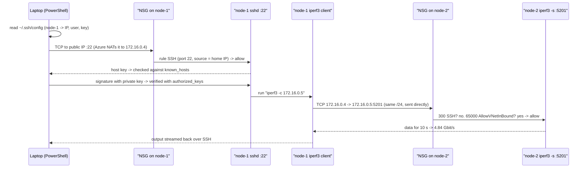

# 00 · Test bed: two Azure VMs, SSH keys, VNet and NSG

[中文版](00-azure-test-bed.zh-CN.md)

> Step type: **infrastructure**. There is no red test. The "proof" is a checklist, run after the work, with real command output.

## 1. Problem

Every later step needs two Linux machines that:

- I can log into from my laptop **without a password**, and run one command remotely (`ssh node-1 "<command>"`);
- can talk to each other on **any port** (ping, `iperf3` on 5201), like two servers on the same switch;
- expose **only SSH** to the internet;
- have a recorded **baseline** (normal latency and bandwidth) before anything is changed.

What was built:

| Item | Value |
|---|---|
| Size | `Standard_B2ats_v2` (2 vCPU, 1 GiB, AMD x64), Ubuntu Server 24.04 LTS |
| Disk | Premium SSD 64 GiB (P6) |
| Network | VNet `vnet-nodecheck`, subnet `172.16.0.0/24`, same availability zone |
| node-1 / node-2 | private IPs `172.16.0.4` / `172.16.0.5` |
| Login | SSH key only (`azureuser`), password login off |
| Firewall | one NSG per NIC; inbound TCP 22 from my home IP only |

**Evidence (2026-11-10)**

```
ssh node-1 hostname            -> node-1
ssh node-2 hostname            -> node-2
sshd -T | grep passwordauth    -> passwordauthentication no   (both)
ip -4 addr show eth0           -> 172.16.0.4/24, 172.16.0.5/24

ssh node-1 "ping -c 10 172.16.0.5"
10 packets transmitted, 10 received, 0% packet loss
rtt min/avg/max/mdev = 0.403/0.515/0.987/0.160 ms

ssh node-1 "iperf3 -c 172.16.0.5 -t 10"      # node-2 ran: iperf3 -s -1 -D
[  5]   0.00-10.00  sec  5.64 GBytes  4.84 Gbits/sec    0   sender
```

**Baseline**: 0.515 ms average RTT, 0% loss, 4.84 Gbit/s, 0 retransmits. Steps 5 and 6 compare against this.

## 2. What it is

**SSH: two key pairs, two directions**

| | Host key | User key |
|---|---|---|
| Proves | the server really is node-1 | I am `azureuser` |
| Private half | on the VM: `/etc/ssh/ssh_host_ed25519_key` | on my laptop: `~/.ssh/node-1_key.pem` |
| Public half | my laptop: `~/.ssh/known_hosts` | the VM: `~/.ssh/authorized_keys` |

- **known_hosts / TOFU** (trust on first use): the first `yes` stores the server's public key. Later connections compare against it. A changed key prints `REMOTE HOST IDENTIFICATION HAS CHANGED`.
- **Public-key login**: the client signs data with the private key; the server verifies with the public key. The private key never leaves the laptop.
- **Private key permissions**: if other users can read the key, `ssh` refuses it (`UNPROTECTED PRIVATE KEY FILE`). On Windows this is fixed with `icacls`.
- **`~/.ssh/config`**: `Host node-1` maps a short name to `HostName`, `User`, `IdentityFile`. The tool can loop over `node-1`, `node-2` without IPs.
- **`ssh host "cmd"`**: runs one command remotely, streams the output back, exits. This is how a validation tool drives many nodes.

**Azure networking**

| Term | Plain words |
|---|---|
| VNet | your private network in Azure (the building) |
| Subnet | a slice of the VNet (a floor). Both VMs are in `172.16.0.0/24` |
| Private IP ranges | `10.0.0.0/8`, `172.16.0.0/12`, `192.168.0.0/16`; not routed on the internet |
| Public IP (Standard SKU) | static; **closed to inbound traffic by default**, so an NSG rule must allow it |
| NSG | a rule table on the NIC. Rules are checked by priority, **lowest number first**; the first match wins |
| Default NSG rules | `AllowVNetInBound` (65000): anything from inside the VNet. `AllowAzureLoadBalancerInBound` (65001). `DenyAllInbound` (65500): everything else |
| Our rule | `SSH`: TCP 22, source = my home IP, allow (priority ~300) |
| `ufw` | the firewall inside Ubuntu. Inactive on Azure images, so only the NSG filters |
| Baseline | the normal values measured before any change; without it, "slower" has no meaning |

## 3. Request path: `ssh node-1 "iperf3 -c 172.16.0.5"`

One command crosses both halves of this step: SSH from home into node-1, then VNet traffic from node-1 to node-2.



The same port 5201, sent from home to node-2's public IP, matches neither rule 300 nor 65000 and falls through to `DenyAllInbound`. The packet is dropped silently, so the client **times out**. A port with no listener inside the VNet (say 5999) is allowed by the NSG, but the kernel answers with RST, so the client gets **`Connection refused`** at once.

## 4. Why this way

| Choice | Why | Alternative and cost |
|---|---|---|
| 🤖 Same VNet, subnet and zone | closest to "same rack"; 0.5 ms baseline, clean | another zone adds latency; another subnet adds routing; another VNet needs peering |
| 🤖 NSG on the NIC (Basic) | portal default, one table per VM | NSG on the subnet: one table for all VMs, more common in production |
| 🤖 Only port 22 open, no test ports | test traffic stays inside the VNet; `AllowVNetInBound` already allows it | opening 5201 from home would allow testing from the laptop, but adds exposure |
| 🤖 SSH source = my IP | only I connect, from a fixed home network | can't do this for CI runners with changing IPs (Skill Swap); then rely on key-only login |
| 🤖 One RSA key from the portal, shared by both VMs | quickest for a practice project | in real teams: one key per person, or SSH certificates; ED25519 is shorter and newer |
| 🤖 `ufw` left off | the NSG already blocks the internet; one fewer layer to debug | production often runs both layers (defence in depth); then check both when debugging |
| B2ats_v2, not B1s | B1s was not available in Australia East for the student subscription | also in the free-hours allowance; region was fixed by an Azure Policy on the subscription |

## 5. Interview questions here

**Summary**: no code to optimise in this step. It covers cloud networking and SSH basics.

| Question | Where | Judgement |
|---|---|---|
| 📒 G3 CI/CD | NSG rule `SSH` | Locked to my IP because only I connect. Skill Swap's GitHub Actions runners have no fixed IP, so there port 22 had to stay open and key-only login carries the risk. **Not needed**: VMs with no public IP, reached via a bastion or VPN |
| 📒 G1 cloud | VNet / NSG / public IP | VNet ≈ AWS VPC, NSG ≈ security group. Azure NSGs can also hold Deny rules, matched by priority |
| 📒 H1 secrets | `node-1_key.pem` | The private key is a secret: kept in `~/.ssh`, readable only by me, `*.pem` in `.gitignore`. Leaking the public key does not matter |
| 📗 TS-JN15, TS-JN16, TS-RN13 | first `ssh` and its yes/no | Host key proves the server; user key proves me; TOFU pins the host key |
| 📗 XL-N4.20, TS-RN23 | refused vs timeout | Refused = reached the host, nothing listening (RST). Timeout = dropped by a firewall |
| ➕ NSG default rules | node-2 NSG rule 65000 | VNet traffic is allowed by default. Change it only for isolation between tenants or subnets |
| 📗 DE-N22, XL-S10.1 | 0.515 ms / 4.84 Gbit/s | Measure normal first; a fault test needs something to compare with |

Scenario anchors:

- "Port 22 was the only inbound rule, but iperf3 on 5201 still worked between the nodes. That's the default AllowVNetInBound rule. From the internet the same port hits DenyAllInbound."
- "Before injecting any faults, I recorded a baseline: about half a millisecond round trip and 4.8 gigabits per second, with zero retransmits."

## 6. Follow-up chain

1. **How do the two VMs talk?** Same VNet and subnet; they use private IPs and never touch the internet.
2. **Only 22 is open. Why does iperf3 work?** `AllowVNetInBound` (65000) allows all VNet traffic. Internet traffic reaches `DenyAllInbound` (65500).
3. **`Connection refused` vs a timeout?** Refused: the packet arrived and the kernel replied RST because nothing listens. Timeout: a firewall dropped it. Check the service in the first case, NSG / `ufw` in the second.
4. **How do you know the server is genuine on first connect?** You don't, that's TOFU. Strictly, compare the fingerprint with one from a trusted channel (e.g. boot diagnostics) before typing yes.
5. **Hundreds of servers?** Pre-distribute host keys, or use SSH certificates signed by an internal CA, or a managed bastion / directory login, so there is no TOFU and no long-lived personal keys on each host.

## 7. Say it in English

- "I put both VMs in the same VNet, subnet and zone, so it's like two servers on the same switch."
- "SSH is the only thing open to the internet, and only from my IP. Node-to-node traffic is allowed by the NSG's default VNet rule."
- "SSH authenticates both sides. The server proves itself with a host key; I prove myself with a private key that never leaves my laptop."
- "My baseline was 0.5 milliseconds and 4.8 gigabits per second. Every fault test compares against that."

## 8. Resources

- OpenSSH `ssh(1)`: `known_hosts`, `authorized_keys`, remote commands — https://man.openbsd.org/ssh
- OpenSSH `ssh_config(5)`: `Host`, `HostName`, `User`, `IdentityFile` — https://man.openbsd.org/ssh_config
- Microsoft Learn, SSH from Windows to an Azure Linux VM — https://learn.microsoft.com/azure/virtual-machines/linux/ssh-from-windows
- Microsoft Learn, NSG overview (see "Default security rules") — https://learn.microsoft.com/azure/virtual-network/network-security-groups-overview
- Microsoft Learn, public IP addresses (Standard SKU: static, closed to inbound by default) — https://learn.microsoft.com/azure/virtual-network/ip-services/public-ip-addresses
- iperf3 options (`-s`, `-c`, `-t`, `-D`) — https://iperf.fr/iperf-doc.php

## 9. Self-test

<details>
<summary>1. Which leak matters: the private key or the public key?</summary>

The private key. Anyone with it can log in wherever the matching public key is in `authorized_keys`. The public key is meant to be handed out.
</details>

<details>
<summary>2. From home, <code>ping</code> node-2's public IP. Does it work?</summary>

No. Ping is ICMP. The only custom rule is TCP 22; home is not in the VNet; so the packet reaches `DenyAllInbound` and is dropped.
</details>

<details>
<summary>3. (Real understanding) Someone adds an NSG rule on node-2: priority 200, any source, port 5201, Deny. Does node-1 → node-2 iperf3 still work? What does the client see?</summary>

No. Priority 200 is checked before `AllowVNetInBound` (65000), so the Deny matches first. The packet is dropped silently, so the client hangs and times out; it does not get "refused". (If the Deny had a priority after 65000, the VNet rule would win and traffic would still pass, but custom rules are limited to 100–4096, so that can't happen.)
</details>

## 10. Replay time

30 minutes (SSH 15 + networking 15).
