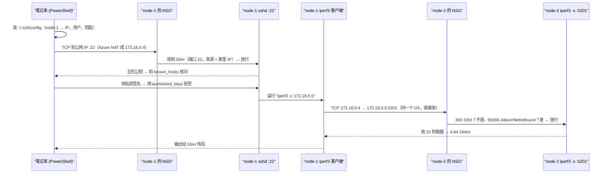

# 00 · 测试环境：两台 Azure VM、SSH 密钥、VNet 和 NSG

[English](00-azure-test-bed.md)

> 步骤类型：**基础设施**。没有红灯测试。"证明"是做完后逐条跑的检查清单，用真实命令输出当证据。

## 1. 问题

后面每一步都需要两台 Linux 机器，满足：

- 从笔记本**不用密码**就能登录，还能远程跑一条命令就回来（`ssh node-1 "<命令>"`）；
- 两台之间**任何端口**都能通（ping、`iperf3` 的 5201），像插在同一台交换机上；
- 对互联网**只露出 SSH**；
- 在动任何东西之前，记下**基线**（正常的延迟和带宽）。

搭出来的东西：

| 项 | 值 |
|---|---|
| 规格 | `Standard_B2ats_v2`（2 vCPU，1 GiB，AMD x64），Ubuntu Server 24.04 LTS |
| 硬盘 | Premium SSD 64 GiB（P6 档） |
| 网络 | VNet `vnet-nodecheck`，子网 `172.16.0.0/24`，同一个可用区 |
| node-1 / node-2 | 私有 IP `172.16.0.4` / `172.16.0.5` |
| 登录 | 只能用 SSH 密钥（`azureuser`），密码登录关闭 |
| 防火墙 | 每张网卡一个 NSG；入站只放行我家 IP 的 TCP 22 |

**证据（2026-11-10）**

```
ssh node-1 hostname            -> node-1
ssh node-2 hostname            -> node-2
sshd -T | grep passwordauth    -> passwordauthentication no   （两台）
ip -4 addr show eth0           -> 172.16.0.4/24, 172.16.0.5/24

ssh node-1 "ping -c 10 172.16.0.5"
10 packets transmitted, 10 received, 0% packet loss
rtt min/avg/max/mdev = 0.403/0.515/0.987/0.160 ms

ssh node-1 "iperf3 -c 172.16.0.5 -t 10"      # node-2 上先跑了 iperf3 -s -1 -D
[  5]   0.00-10.00  sec  5.64 GBytes  4.84 Gbits/sec    0   sender
```

**基线**：平均往返 0.515 ms，丢包 0%，带宽 4.84 Gbit/s，重传 0。第 5、6 步拿它对比。

## 2. 是什么

**SSH：两对钥匙，两个方向**

| | 主机密钥（host key） | 用户密钥（user key） |
|---|---|---|
| 证明谁 | 服务器真的是 node-1 | 我是 `azureuser` |
| 私钥在哪 | VM：`/etc/ssh/ssh_host_ed25519_key` | 笔记本：`~/.ssh/node-1_key.pem` |
| 公钥在哪 | 笔记本：`~/.ssh/known_hosts` | VM：`~/.ssh/authorized_keys` |

- **known_hosts / TOFU**（Trust On First Use，第一次见面就信任）：第一次输 `yes`，记下服务器的公钥；以后每次核对。公钥变了就报 `REMOTE HOST IDENTIFICATION HAS CHANGED`。
- **公钥登录**：客户端用私钥签名，服务器用公钥验签。私钥从不离开笔记本。
- **私钥权限**：别的用户能读私钥，`ssh` 就拒绝使用（`UNPROTECTED PRIVATE KEY FILE`）。Windows 上用 `icacls` 收紧。
- **`~/.ssh/config`**：`Host node-1` 把外号映射到 `HostName`、`User`、`IdentityFile`。工具循环 `node-1`、`node-2` 时不用写 IP。
- **`ssh 主机 "命令"`**：远程跑一条命令，输出传回来，然后断开。验收工具就是这样驱动很多台机器的。

**Azure 网络**

| 术语 | 大白话 |
|---|---|
| VNet | 你在 Azure 里的私有网络（一栋楼） |
| 子网 | VNet 里切出来的一块（一层楼）。两台都在 `172.16.0.0/24` |
| 私有 IP 三个网段 | `10.0.0.0/8`、`172.16.0.0/12`、`192.168.0.0/16`；互联网上不路由 |
| 公网 IP（Standard SKU） | 静态；**默认关闭所有入站**，必须有 NSG 规则放行 |
| NSG | 挂在网卡上的规则表。按优先级**数字从小到大**匹配，第一条命中的说了算 |
| NSG 默认规则 | `AllowVNetInBound`（65000）：VNet 里来的都放行。`AllowAzureLoadBalancerInBound`（65001）。`DenyAllInbound`（65500）：其余全拒 |
| 我们加的规则 | `SSH`：TCP 22，来源 = 我家 IP，放行（优先级约 300） |
| `ufw` | Ubuntu 里面的防火墙。Azure 镜像默认关闭，所以只有 NSG 在过滤 |
| 基线（baseline） | 改动之前量到的正常值。没有它，"变慢了"无从说起 |

## 3. 请求路径导读：`ssh node-1 "iperf3 -c 172.16.0.5"`

一条命令把这一步的两半都走了一遍：先从家里 SSH 进 node-1，再从 node-1 走 VNet 到 node-2。



同样是 5201，如果从家里发到 node-2 的公网 IP：既不命中 300，也不命中 65000，一直落到 `DenyAllInbound`，包被悄悄丢掉，客户端**超时**。VNet 里连一个没人监听的端口（比如 5999）：NSG 放行了，但内核回 RST，客户端立刻看到 **`Connection refused`**。

## 4. 为什么这样用

| 选择 | 为什么 | 替代方案和代价 |
|---|---|---|
| 🤖 同一 VNet、同一子网、同一可用区 | 最接近"同一机架"；基线 0.5 ms，很干净 | 跨可用区延迟更高；跨子网要过路由；跨 VNet 要配 peering |
| 🤖 NSG 挂在网卡上（Basic） | 门户默认，每台一张表 | 挂在子网上：一张表管所有 VM，生产环境更常见 |
| 🤖 只开 22，不开测试端口 | 测试流量只走 VNet 内部，`AllowVNetInBound` 已经放行 | 从家里开 5201 就能用笔记本测，但多一个暴露面 |
| 🤖 SSH 来源 = 我家 IP | 只有我从固定的家庭网络连 | CI runner 的 IP 不固定时做不到（Skill Swap），只能靠"只认密钥"兜底 |
| 🤖 门户生成一把 RSA 密钥，两台共用 | 练习项目，最快 | 真实团队每人一把，或用 SSH 证书；ED25519 更短更新 |
| 🤖 不开 `ufw` | NSG 已挡住公网；少一层少一个排查点 | 生产常两层都开（纵深防御），排查时两层都要看 |
| B2ats_v2，不是 B1s | Australia East 里学生订阅没有 B1s | 也在免费时长里；区域被订阅自带的 Azure Policy 限死了 |

## 5. 八股在这里

**结论**：这一步没有要优化的代码，碰到的是云网络和 SSH 的基本功。

| 八股 | 在哪 | 这里的判断 |
|---|---|---|
| 📒 G3 CI/CD | NSG 规则 `SSH` | 只有我连，所以收紧到我的 IP。Skill Swap 的 GitHub Actions runner IP 不固定，22 只能对外开，靠只认密钥兜底。**不需要的情况**：没有公网 IP、只从跳板机或 VPN 进的机器 |
| 📒 G1 云经验 | VNet / NSG / 公网 IP | VNet ≈ AWS VPC，NSG ≈ Security Group。Azure NSG 还能写 Deny，按优先级匹配 |
| 📒 H1 secrets | `node-1_key.pem` | 私钥是 secret：放 `~/.ssh`、只有自己能读、`.gitignore` 有 `*.pem`。公钥泄露无所谓 |
| 📗 TS-JN15、TS-JN16、TS-RN13 | 第一次 `ssh` 的 yes/no | 主机密钥证明服务器，用户密钥证明我，TOFU 记住主机公钥 |
| 📗 XL-N4.20、TS-RN23 | refused 和超时 | refused = 到了没人听（RST）；超时 = 被防火墙丢了 |
| ➕ NSG 默认规则 | node-2 NSG 的 65000 | VNet 内默认全放行。只有要隔离租户或子网时才改 |
| 📗 DE-N22、XL-S10.1 | 0.515 ms / 4.84 Gbit/s | 先测正常值，故障测试才有对比 |

场景锚点（英文）：

- "Port 22 was the only inbound rule, but iperf3 on 5201 still worked between the nodes. That's the default AllowVNetInBound rule. From the internet the same port hits DenyAllInbound."
- "Before injecting any faults, I recorded a baseline: about half a millisecond round trip and 4.8 gigabits per second, with zero retransmits."

## 6. 面试追问链

1. **两台 VM 怎么通信？** 同一 VNet 同一子网，用私有 IP，不经过互联网。
2. **只开了 22，iperf3 怎么通的？** `AllowVNetInBound`（65000）放行 VNet 内所有流量；互联网来的落到 `DenyAllInbound`（65500）。
3. **`Connection refused` 和超时有什么区别？** refused：包到了，没人监听，内核回 RST。超时：被防火墙丢了。前者查服务，后者查 NSG / `ufw`。
4. **第一次连，怎么知道服务器是真的？** 其实不知道，这就是 TOFU。严格做法是先从可信渠道（比如 boot diagnostics）拿到指纹，比对后再输 yes。
5. **几百台服务器怎么办？** 预先分发主机公钥；或用内部 CA 签的 SSH 证书；或用托管的跳板机 / 目录账号登录。这样没有 TOFU，也不用在每台机器上放长期的个人密钥。

## 7. 英文说法

- "I put both VMs in the same VNet, subnet and zone, so it's like two servers on the same switch."
- "SSH is the only thing open to the internet, and only from my IP. Node-to-node traffic is allowed by the NSG's default VNet rule."
- "SSH authenticates both sides. The server proves itself with a host key; I prove myself with a private key that never leaves my laptop."
- "My baseline was 0.5 milliseconds and 4.8 gigabits per second. Every fault test compares against that."

## 8. 资料

- OpenSSH `ssh(1)`：`known_hosts`、`authorized_keys`、远程执行命令 — https://man.openbsd.org/ssh
- OpenSSH `ssh_config(5)`：`Host`、`HostName`、`User`、`IdentityFile` — https://man.openbsd.org/ssh_config
- Microsoft Learn：从 Windows 用 SSH 连 Azure Linux VM — https://learn.microsoft.com/azure/virtual-machines/linux/ssh-from-windows
- Microsoft Learn：NSG 概述（看 "Default security rules"）— https://learn.microsoft.com/azure/virtual-network/network-security-groups-overview
- Microsoft Learn：公网 IP（Standard SKU：静态、默认关闭入站）— https://learn.microsoft.com/azure/virtual-network/ip-services/public-ip-addresses
- iperf3 参数（`-s`、`-c`、`-t`、`-D`）— https://iperf.fr/iperf-doc.php

## 9. 自测题

<details>
<summary>1. 私钥和公钥，哪个泄露了要紧？</summary>

私钥。有私钥就能登录所有 `authorized_keys` 里放了对应公钥的机器。公钥本来就是给别人的。
</details>

<details>
<summary>2. 从家里 <code>ping</code> node-2 的公网 IP，通吗？</summary>

不通。ping 是 ICMP。自定义规则只有 TCP 22；家里不在 VNet 里；所以落到 `DenyAllInbound` 被丢掉。
</details>

<details>
<summary>3.（真懂才答得出）有人在 node-2 的 NSG 加了一条：优先级 200、来源任意、端口 5201、Deny。node-1 → node-2 的 iperf3 还通吗？客户端看到什么？</summary>

不通。200 比 `AllowVNetInBound`（65000）先匹配，Deny 先命中。包被悄悄丢掉，客户端卡住直到超时，不是 refused。（如果 Deny 排在 65000 后面，VNet 规则先命中、流量照样通；但自定义规则的优先级只能填 100–4096，所以排不到后面。）
</details>

## 10. 预计回放时间

30 分钟（SSH 15 + 网络 15）。
