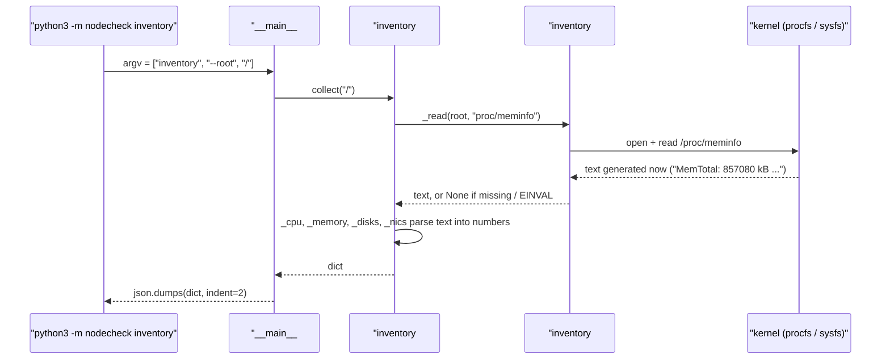

# 01 · Hardware inventory from /proc and /sys

[中文版](01-proc-and-sys.zh-CN.md)

> Step type: **missing behaviour** (red → green).
> Red: `3221f2a test(red): step 1 hardware inventory from /proc and /sys`. Green: the `feat` commit after it.

## 1. Problem

Before a server is handed over, someone must write down what is actually in it: CPU, memory, disks, NICs, firmware, kernel. Step 2 will compare that against the spec. This step produces the list, as JSON, without installing anything and without root.

Reproduced by `tests/test_inventory.py` (8 tests). With `collect()` returning only empty values, all 8 failed on assertions such as `assert None == 'AMD EPYC 7763 64-Core Processor'`.

```
$ python3 -m nodecheck inventory --root tests/fixtures/node-1
{ "hostname": "node-1", "kernel": "7.0.0-1017-azure", "os": "Ubuntu 24.04.5 LTS",
  "system": {"vendor": "Microsoft Corporation", "product": "Virtual Machine"},
  "cpu": {"model": "AMD EPYC 7763 64-Core Processor", "logical_cpus": 2, "physical_cores": 1},
  "memory": {"total_kib": 857080, "available_kib": 594096},
  "disks": [{"name": "sda", "size_bytes": 68719476736, "rotational": true, "vendor": "Msft", "model": "Virtual Disk"}],
  "nics": [{"name": "eth0", "mac": "60:45:bd:e5:04:a6", "mtu": 1500, "state": "up", "speed_mbps": 50000}] }
```

## 2. What it is

**`/proc` and `/sys` are not on disk.** They are pseudo filesystems: the kernel generates each file's text at the moment you read it. `ls -l` shows size 0, which is why `scripts/capture_fixture.sh` copies them with `cat`, not `cp` or `tar`.

| Path | What the kernel puts there | Same facts in | Used in |
|---|---|---|---|
| `/proc/cpuinfo` | one block per **logical** CPU: `model name`, `physical id` (socket), `core id` | `lscpu` (reads this file); `nproc` (asks the scheduler, same count) | `inventory#_cpu` |
| `/proc/meminfo` | memory counters in kB | `free`, `top` (read this file) | `inventory#_memory` |
| `/proc/sys/kernel/osrelease`, `hostname` | kernel version, hostname | `uname -r`, `hostname` (same data via a system call) | `inventory#collect` |
| `/etc/os-release` | distro name (a normal file, not from the kernel) | `hostnamectl` | `inventory#_os_name` |
| `/sys/class/dmi/id/*` | firmware (SMBIOS/DMI) tables: vendor, product, BIOS. Serial numbers are root-only | `dmidecode` | `inventory#collect` |
| `/sys/block/<disk>/size` | size in **512-byte sectors**, always | `lsblk` (reads sysfs) | `inventory#_disks` |
| `/sys/block/<disk>/queue/rotational` | 1 = spinning disk, as the driver reports it | `lsblk -o ROTA` | `inventory#_disks` |
| `/sys/class/net/<if>/address`, `mtu`, `operstate`, `speed` | NIC facts; `speed` in Mbit/s, or an error if unknown | `ip link`, `ethtool` (ask via netlink / ioctl) | `inventory#_nics` |

`/proc` is the older interface (processes plus loosely formatted kernel info). `/sys` (sysfs) is the device model: one value per file, devices grouped under `block/`, `class/`, etc.

**Memory: which number?**

| Field | Meaning | Use |
|---|---|---|
| `MemTotal` | usable RAM: physical RAM minus firmware/kernel reservations | "how much is installed": compared with the spec in step 2 |
| `MemFree` | RAM nobody is using at all | **not reported**: Linux fills spare RAM with cache, so this looks small on a healthy machine |
| `MemAvailable` | estimate of what a new program can get without swapping, counting cache the kernel can drop | "how much is left" |

**Four things the real VM data showed**

| Seen | Meaning |
|---|---|
| `cpu cores: 1`, `siblings: 2`, 2 blocks | Azure's "2 vCPU" = **1 physical core × 2 hyperthreads** (`lscpu`: `Thread(s) per core: 2`) |
| `MemTotal: 857080 kB` (0.82 GiB) | sold as 1 GiB; the rest is reserved before Linux sees it. Step 2 needs a tolerance |
| `rotational = 1` on a Premium SSD | the virtual disk driver doesn't report media type. Don't trust it in a VM |
| `speed = 50000` (50 Gbit/s) | measured throughput was 4.84 Gbit/s. A NIC's claimed speed is not what you get |

## 3. Code path: `python3 -m nodecheck inventory`



In tests, `root` is `tests/fixtures/node-1`, so `_read` opens `tests/fixtures/node-1/proc/meminfo` instead. `collect()` cannot tell the difference. That one parameter is what makes the code testable without a VM.

## 4. Why this way

| Choice | Why | Alternative and cost |
|---|---|---|
| 🤖 Read files, not commands | no packages, no root, no output-format parsing; fixtures are plain copies | `lscpu`/`lsblk -J` give richer output, but each has its own format and version differences; `dmidecode` needs root |
| 🤖 `root` parameter instead of mocking `open` | tests use real files at real relative paths; the same code runs on a node and in tests | mocking hides path mistakes; a fake root catches them |
| 🤖 Missing / unreadable file → `None` | real fleets have odd nodes (no DMI, NIC without speed); an inventory should still finish | raising would stop the whole run on one missing file |
| 🤖 Skip `loop*`, `ram*` disks and `lo` | they are software devices (snap images, RAM disks, loopback), not hardware | listing them adds noise; 8 empty loop devices on each VM |
| 🤖 Report `MemTotal` + `MemAvailable`, not `MemFree` | total for the spec, available for headroom | `MemFree` reads as "almost full" on any machine with cache |
| 🤖 Keep `rotational` even though Azure gets it wrong | on bare metal it's correct and useful; the doc records why it's wrong here | dropping it would hide a real hardware fact |
| Cross-check with `nproc`, `free`, `lsblk` output in tests | proves our numbers match the tools people already trust | — |

## 5. Interview questions here

**Summary**: no performance trick is needed. The judgement is **which file and which field** to trust.

| Question | Where in code | Judgement |
|---|---|---|
| 📗 TS-RS26 Explain the /proc filesystem | `inventory#_read` | Pseudo filesystem; content generated on read. That's why fixtures are captured with `cat` |
| 📗 XL-S3.1 kernel vs user space windows | `inventory#collect` | `/proc` and `/sys` are how user space reads kernel data without root |
| 📗 DE-L硬件1 where is CPU info | `inventory#_cpu` | `/proc/cpuinfo`; logical = blocks, physical = unique (`physical id`, `core id`) |
| 📗 DE-L硬件2 BIOS / motherboard / RAM | `collect` → `sys/class/dmi/id` | Vendor and product are world-readable; serials need root (`dmidecode`). **Not needed here**: no serials in a VM |
| 📗 DE-L硬件3 block devices | `inventory#_disks` | `/sys/block`, size × 512. Skip loop devices |
| 📗 DE-L内存1 MemFree vs MemAvailable | `inventory#_memory` | Report Available, never Free. **When Free matters**: almost never for capacity questions |
| 📗 TS-JS6 first 5 commands on a server | the whole inventory | This tool is an automated version of that first look |
| ➕ vCPU = hyperthread | `inventory#_cpu` | 2 vCPU = 1 core × 2 threads; benchmarks with 2 workers share one core |
| ➕ Virtual hardware lies | `rotational`, `speed` | Compare with the **VM size spec**, not physical hardware; measure instead of trusting claims |

Scenario anchors:

- "The inventory reads /proc and /sys directly, the same files lscpu and free read. My tests check our numbers against their output."
- "On Azure, two vCPUs turned out to be one core with two hyperthreads, and memory was 0.82 GiB, not 1. So step 2 compares with a tolerance."
- "The NIC claims 50 gigabits, but I measured 4.8. Claimed specs and measured performance are different checks."

## 6. Follow-up chain

1. **Where do you get CPU and memory info on Linux?** `/proc/cpuinfo`, `/proc/meminfo`; `lscpu` and `free` read them too.
2. **What is `/proc`, physically?** Nothing on disk. The kernel generates the text when you read it, so file sizes show 0.
3. **`/proc` vs `/sys`?** `/proc`: processes and older, free-form kernel info. `/sys`: the device model, one value per file, stable paths like `/sys/block/sda/size`.
4. **Why not `MemFree`?** Linux uses spare RAM as page cache. `MemAvailable` counts the cache it can drop; `MemFree` doesn't, so it looks tiny on healthy machines.
5. **The VM shows 2 CPUs but 1 core. Which do you compare with "2 vCPU"?** Logical CPUs. A vCPU is a hardware thread. It matters for benchmarks: two CPU-bound workers compete for one core.
6. **How would you get the serial number?** `dmidecode` or `/sys/class/dmi/id/product_serial`, both root-only. Serials are sensitive, so they're not world-readable.

## 7. Say it in English

- "Linux exposes hardware as files. /proc has CPU and memory, /sys has disks, NICs and firmware."
- "My inventory reads those files directly, so it needs no extra packages and no root."
- "For memory I report MemTotal for the spec and MemAvailable for headroom. MemFree is misleading because of the page cache."
- "Tests run on real copies of those files from the VMs, and cross-check against nproc, free and lsblk."

## 8. Resources

- Linux kernel docs, The /proc filesystem (see `/proc/meminfo`) — https://docs.kernel.org/filesystems/proc.html
- `proc_meminfo(5)` man page: MemTotal, MemFree, MemAvailable — https://man7.org/linux/man-pages/man5/proc_meminfo.5.html
- Linux kernel docs, sysfs (what `/sys/block` and `/sys/class` contain) — https://docs.kernel.org/filesystems/sysfs.html
- Linux kernel docs, ABI stable symbols under `/sys/block` (`queue/rotational`) — https://docs.kernel.org/admin-guide/abi-stable.html#symbols-under-sys-block
- Microsoft Learn, Basv2 sizes (B2ats_v2: 2 vCPU, 1 GiB, no temp disk, AMD EPYC 7763) — https://learn.microsoft.com/azure/virtual-machines/sizes/general-purpose/basv2-series

## 9. Self-test

<details>
<summary>1. Why does <code>tar czf x.tgz /proc/meminfo</code> give an empty file?</summary>

`/proc` files report size 0; their content is generated only when read. `tar` trusts the size and archives 0 bytes. `cat` reads until the kernel stops writing, so it gets the text.
</details>

<details>
<summary>2. A healthy server shows MemFree = 300 MB of 1 GB. Is it short of memory?</summary>

Not necessarily. Linux keeps file data in page cache. Look at MemAvailable (here ~590 MB), which counts cache that can be dropped.
</details>

<details>
<summary>3. (Real understanding) The spec says "2 vCPU, 1 GiB, SSD". The inventory says logical_cpus 2, physical_cores 1, total_kib 857080, rotational true. Which of these should step 2 mark FAIL?</summary>

None. vCPU means logical CPU, so 2 matches. MemTotal is RAM minus firmware/kernel reservations, so 0.82 GiB of 1 GiB is expected; compare with a tolerance. `rotational` is wrong on Azure virtual disks, so it can't be checked against "SSD" on this platform. A naive exact check would raise three false alarms.
</details>

## 10. Replay time

30 minutes.
