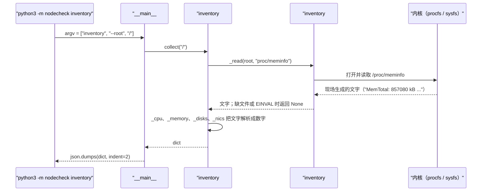

# 01 · 从 /proc 和 /sys 读硬件清单

[English](01-proc-and-sys.md)

> 步骤类型：**补缺的行为**（红 → 绿）。
> 红：`3221f2a test(red): step 1 hardware inventory from /proc and /sys`。绿：紧跟在后面的 `feat` 提交。

## 1. 问题

服务器交付前，要有人写下它里面**实际**有什么：CPU、内存、硬盘、网卡、固件、内核。第 2 步拿这份清单和规格对比。这一步负责产出清单（JSON），不装任何东西、不要 root。

复现：`tests/test_inventory.py`（8 个测试）。`collect()` 只返回空值时，8 个全部失败，都是断言失败，比如 `assert None == 'AMD EPYC 7763 64-Core Processor'`。

```
$ python3 -m nodecheck inventory --root tests/fixtures/node-1
{ "hostname": "node-1", "kernel": "7.0.0-1017-azure", "os": "Ubuntu 24.04.5 LTS",
  "system": {"vendor": "Microsoft Corporation", "product": "Virtual Machine"},
  "cpu": {"model": "AMD EPYC 7763 64-Core Processor", "logical_cpus": 2, "physical_cores": 1},
  "memory": {"total_kib": 857080, "available_kib": 594096},
  "disks": [{"name": "sda", "size_bytes": 68719476736, "rotational": true, "vendor": "Msft", "model": "Virtual Disk"}],
  "nics": [{"name": "eth0", "mac": "60:45:bd:e5:04:a6", "mtu": 1500, "state": "up", "speed_mbps": 50000}] }
```

## 2. 是什么

**`/proc` 和 `/sys` 不在硬盘上。** 它们是伪文件系统（pseudo filesystem）：你读的那一刻，内核才现场生成文件内容。`ls -l` 看大小都是 0，所以 `scripts/capture_fixture.sh` 用 `cat` 抄，不用 `cp` 或 `tar`。

| 路径 | 内核放了什么 | 同样的信息还在哪 | 代码在哪 |
|---|---|---|---|
| `/proc/cpuinfo` | 每个**逻辑** CPU 一段：`model name`、`physical id`（插槽）、`core id`（核） | `lscpu`（读这个文件）；`nproc`（问调度器，数一样） | `inventory#_cpu` |
| `/proc/meminfo` | 内存计数，单位 kB | `free`、`top`（读这个文件） | `inventory#_memory` |
| `/proc/sys/kernel/osrelease`、`hostname` | 内核版本、主机名 | `uname -r`、`hostname`（走系统调用，数据相同） | `inventory#collect` |
| `/etc/os-release` | 发行版名字（普通文件，不是内核生成的） | `hostnamectl` | `inventory#_os_name` |
| `/sys/class/dmi/id/*` | 固件（SMBIOS/DMI）表：厂商、型号、BIOS。序列号只有 root 能读 | `dmidecode` | `inventory#collect` |
| `/sys/block/<盘>/size` | 大小，单位**永远是 512 字节一格** | `lsblk`（读 sysfs） | `inventory#_disks` |
| `/sys/block/<盘>/queue/rotational` | 1 = 机械盘（驱动说的） | `lsblk -o ROTA` | `inventory#_disks` |
| `/sys/class/net/<网卡>/address`、`mtu`、`operstate`、`speed` | 网卡信息；`speed` 单位 Mbit/s，不知道时读会报错 | `ip link`、`ethtool`（走 netlink / ioctl） | `inventory#_nics` |

`/proc` 是老接口（进程信息 + 格式随意的内核信息）。`/sys`（sysfs）是设备模型：一个文件一个值，设备按 `block/`、`class/` 等分组。

**内存报哪个数**

| 字段 | 意思 | 用途 |
|---|---|---|
| `MemTotal` | 可用的物理内存：物理内存减去固件和内核预留 | "装了多少"：第 2 步和规格比 |
| `MemFree` | 完全没人用的内存 | **不报**：Linux 会把空闲内存拿去当缓存，健康的机器上它也很小 |
| `MemAvailable` | 估算新程序还能拿到多少（不用 swap），算上了内核能随时丢掉的缓存 | "还剩多少" |

**真实 VM 数据里看到的四件事**

| 看到的 | 意思 |
|---|---|
| `cpu cores: 1`、`siblings: 2`，共 2 段 | Azure 的 "2 vCPU" = **1 个物理核 × 2 个超线程**（`lscpu`：`Thread(s) per core: 2`） |
| `MemTotal: 857080 kB`（0.82 GiB） | 卖的是 1 GiB；剩下的在 Linux 看到之前就被预留了。第 2 步要留余量 |
| Premium SSD 却 `rotational = 1` | 虚拟盘的驱动不报介质类型。在 VM 上不能信 |
| `speed = 50000`（50 Gbit/s） | 实测 4.84 Gbit/s。网卡声称的速率不等于能跑多快 |

## 3. 代码路径：`python3 -m nodecheck inventory`



测试里 `root` 是 `tests/fixtures/node-1`，`_read` 打开的就是 `tests/fixtures/node-1/proc/meminfo`。`collect()` 分不出区别。就是这一个参数，让代码不用 VM 也能测。

## 4. 为什么这样用

| 选择 | 为什么 | 替代方案和代价 |
|---|---|---|
| 🤖 读文件，不调命令 | 不装包、不要 root、不用解析各种命令的输出格式；fixture 就是原样拷贝 | `lscpu`、`lsblk -J` 信息更全，但格式各异、版本间有差别；`dmidecode` 要 root |
| 🤖 用 `root` 参数，不 mock `open` | 测试用真文件、真相对路径；同一份代码在机器上和测试里都能跑 | mock 会掩盖路径写错；假根目录能抓出来 |
| 🤖 缺文件 / 读不了 → `None` | 真实机房总有怪机器（没 DMI、网卡报不出速率），清单还是要跑完 | 一报错就停，一个文件缺了整台都没结果 |
| 🤖 跳过 `loop*`、`ram*` 盘和 `lo` | 它们是软件设备（snap 镜像、内存盘、回环），不是硬件 | 列出来全是噪音：每台 VM 有 8 个空 loop |
| 🤖 报 `MemTotal` + `MemAvailable`，不报 `MemFree` | total 比规格，available 看余量 | `MemFree` 在任何有缓存的机器上都像"快满了" |
| 🤖 保留 `rotational`，即使 Azure 报错 | 物理机上它是对的、有用；文档里记下这里为什么错 | 删掉就藏起了一个真实的硬件信息 |
| 测试里拿 `nproc`、`free`、`lsblk` 的输出对照 | 证明我们的数和大家信任的工具一致 | — |

## 5. 八股在这里

**结论**：这一步不需要性能上的优化。要判断的是**信哪个文件、哪个字段**。

| 八股 | 代码在哪 | 这里的判断 |
|---|---|---|
| 📗 TS-RS26 解释 /proc | `inventory#_read` | 伪文件系统，读的时候现生成。所以 fixture 要用 `cat` 抄 |
| 📗 XL-S3.1 内核和用户态 | `inventory#collect` | `/proc`、`/sys` 是用户态不要 root 就能读内核数据的窗口 |
| 📗 DE-L硬件1 CPU 信息在哪 | `inventory#_cpu` | `/proc/cpuinfo`；逻辑核数 = 段数，物理核数 = 不重复的（`physical id`, `core id`） |
| 📗 DE-L硬件2 BIOS / 主板 / 内存 | `collect` → `sys/class/dmi/id` | 厂商、型号所有人能读；序列号要 root（`dmidecode`）。**这里不需要**：VM 没有有意义的序列号 |
| 📗 DE-L硬件3 块设备 | `inventory#_disks` | `/sys/block`，size × 512，跳过 loop |
| 📗 DE-L内存1 MemFree 和 MemAvailable | `inventory#_memory` | 报 Available，不报 Free。**什么时候看 Free**：问容量的时候几乎不看 |
| 📗 TS-JS6 登上服务器先敲哪 5 条命令 | 整份清单 | 这个工具就是"第一眼"的自动化版本 |
| ➕ vCPU = 超线程 | `inventory#_cpu` | 2 vCPU = 1 核 × 2 线程；跑分时 2 个 worker 抢同一个核 |
| ➕ 虚拟硬件会"说谎" | `rotational`、`speed` | 和 **VM 机型规格**比，不和物理机比；能测的就测，不信声称值 |

场景锚点（英文）：

- "The inventory reads /proc and /sys directly, the same files lscpu and free read. My tests check our numbers against their output."
- "On Azure, two vCPUs turned out to be one core with two hyperthreads, and memory was 0.82 GiB, not 1. So step 2 compares with a tolerance."
- "The NIC claims 50 gigabits, but I measured 4.8. Claimed specs and measured performance are different checks."

## 6. 面试追问链

1. **Linux 上 CPU、内存信息去哪看？** `/proc/cpuinfo`、`/proc/meminfo`；`lscpu`、`free` 也是读它们。
2. **`/proc` 物理上是什么？** 硬盘上什么都没有。读的时候内核现生成，所以文件大小显示 0。
3. **`/proc` 和 `/sys` 有什么区别？** `/proc`：进程和老的、格式随意的内核信息。`/sys`：设备模型，一个文件一个值，路径稳定，比如 `/sys/block/sda/size`。
4. **为什么不用 `MemFree`？** Linux 把空闲内存拿来做页缓存。`MemAvailable` 把能丢掉的缓存也算进去；`MemFree` 不算，健康机器上也显得很小。
5. **VM 显示 2 个 CPU、1 个核，和 "2 vCPU" 比哪个？** 比逻辑 CPU。一个 vCPU 就是一个硬件线程。跑分时有影响：两个吃 CPU 的进程在抢同一个核。
6. **序列号怎么拿？** `dmidecode` 或 `/sys/class/dmi/id/product_serial`，都要 root。序列号算敏感信息，所以不给普通用户读。

## 7. 英文说法

- "Linux exposes hardware as files. /proc has CPU and memory, /sys has disks, NICs and firmware."
- "My inventory reads those files directly, so it needs no extra packages and no root."
- "For memory I report MemTotal for the spec and MemAvailable for headroom. MemFree is misleading because of the page cache."
- "Tests run on real copies of those files from the VMs, and cross-check against nproc, free and lsblk."

## 8. 资料

- Linux 内核文档：/proc 文件系统（看 `/proc/meminfo` 一节）— https://docs.kernel.org/filesystems/proc.html
- `proc_meminfo(5)` 手册：MemTotal、MemFree、MemAvailable — https://man7.org/linux/man-pages/man5/proc_meminfo.5.html
- Linux 内核文档：sysfs（`/sys/block`、`/sys/class` 里是什么）— https://docs.kernel.org/filesystems/sysfs.html
- Linux 内核文档：`/sys/block` 下的稳定 ABI（`queue/rotational`）— https://docs.kernel.org/admin-guide/abi-stable.html#symbols-under-sys-block
- Microsoft Learn：Basv2 系列（B2ats_v2：2 vCPU、1 GiB、无临时盘、AMD EPYC 7763）— https://learn.microsoft.com/azure/virtual-machines/sizes/general-purpose/basv2-series

## 9. 自测题

<details>
<summary>1. 为什么 <code>tar czf x.tgz /proc/meminfo</code> 打出来是空文件？</summary>

`/proc` 的文件大小报 0，内容只在读的时候生成。`tar` 相信大小，存了 0 字节。`cat` 一直读到内核写完为止，所以能拿到内容。
</details>

<details>
<summary>2. 一台健康的服务器，1 GB 内存里 MemFree 只有 300 MB。它内存不够了吗？</summary>

不一定。Linux 会把文件数据留在页缓存里。看 MemAvailable（这里约 590 MB），它把能丢掉的缓存也算进去了。
</details>

<details>
<summary>3.（真懂才答得出）规格写 "2 vCPU、1 GiB、SSD"。清单读出 logical_cpus 2、physical_cores 1、total_kib 857080、rotational true。第 2 步哪几项该判 FAIL？</summary>

一项都不该。vCPU 指逻辑 CPU，2 对得上。MemTotal 是内存减去固件和内核预留，1 GiB 里看到 0.82 GiB 是正常的，要带余量比较。`rotational` 在 Azure 虚拟盘上是错的，这个平台上不能拿它对 "SSD"。如果直接按"完全相等"去比，会报三个假警报。
</details>

## 10. 预计回放时间

30 分钟。
