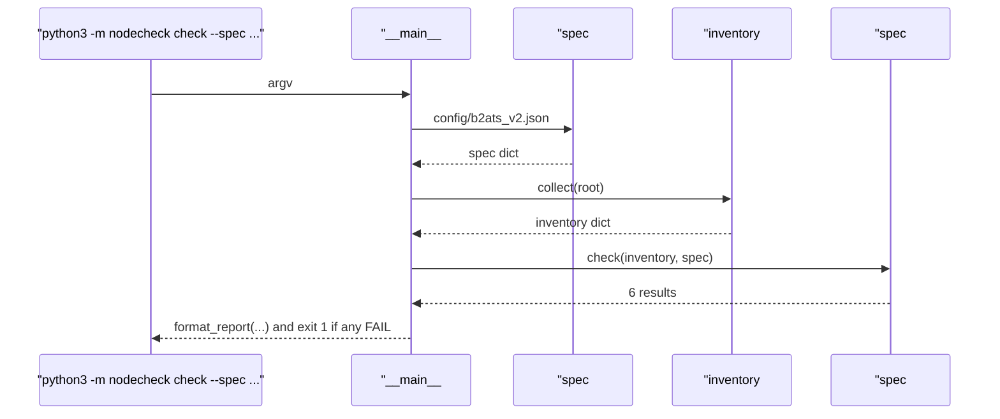
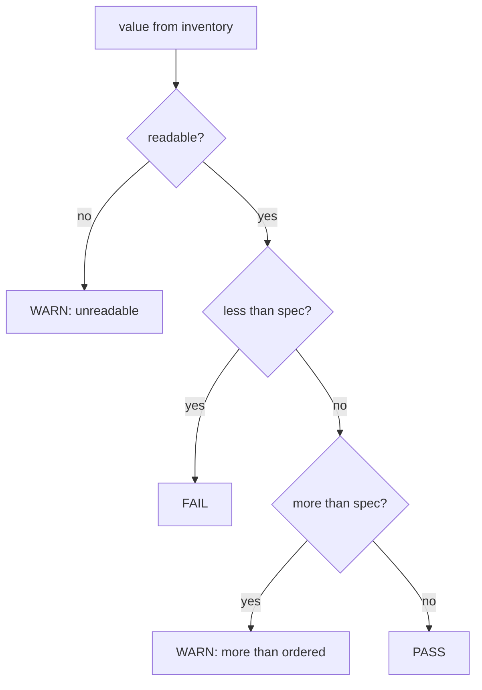

# 02 · Checking a node against its machine-type spec

[中文版](02-spec-check.zh-CN.md)

> Step type: **missing behaviour** (red → green).

## 1. Problem

The inventory says what a node *has*. Acceptance needs a verdict: does it match what was *ordered*? A naive "must equal the spec" check gives false alarms on a perfectly good Azure VM (0.82 GiB visible of 1 GiB; an SSD that reports itself as spinning). Too loose a check misses real faults (a missing core, a NIC that is down).

Reproduced by `tests/test_spec.py` (20 cases). They start from node-1's real inventory and change one field per case. With `check()` returning no results, every case failed with `assert None == 'PASS'` (or `'FAIL'`, `'WARN'`).

```
$ python3 -m nodecheck check --spec config/b2ats_v2.json --root tests/fixtures/node-1
Spec: Azure Standard_B2ats_v2
  cpu        2 logical CPUs               expected 2                                      PASS
  memory     0.82 GiB                     expected >= 0.80 GiB (1 GiB x 0.8)              PASS
  disk       sda 64 GiB                   expected >= 64 GiB                              PASS
  disk_type  not trusted here             expected ssd (not verifiable on this platform)  WARN
  nics       1 up (eth0)                  expected >= 1 up                                PASS
  os         Ubuntu 24.04.5 LTS           expected Ubuntu 24.04*                          PASS
Result: 0 FAIL, 1 WARN
$ echo $?
0
```

## 2. What it is

**A spec per machine type.** Data centres accept servers by SKU: one table for a whole batch, not one per server. `config/b2ats_v2.json` is the table for `Standard_B2ats_v2`:

| Key | Value | Why |
|---|---|---|
| `cpu.logical_cpus` | 2 | Azure sells vCPUs, and a vCPU is a hardware thread (here 1 core × 2 threads) |
| `memory.gib`, `memory.min_ratio` | 1, 0.8 | `MemTotal` excludes firmware/kernel reservations. Measured 0.82. The ratio lives in the spec so a big server can use 0.95 |
| `disk.min_size_gib` | 64 | the OS disk we provisioned |
| `disk.type`, `disk.check_type` | "ssd", false | Azure disks report `rotational=1` even on Premium SSD; set `true` on bare metal |
| `nics.min_up` | 1 | presence and link state only; claimed speed (50 Gbit/s) isn't trusted |
| `os.prefix` | "Ubuntu 24.04" | point releases (24.04.5) still match |

**Three statuses**

| Status | Meaning | Examples |
|---|---|---|
| FAIL | less than the spec, or missing. Not fit to hand over | 1 CPU instead of 2; 0.79 GiB; no 64 GiB disk; NIC down; Ubuntu 22.04 |
| WARN | not wrong, but a person should look | 4 CPUs (more than ordered); a value couldn't be read; disk type not verifiable on Azure |
| PASS | matches | |

**Exit code.** `check` exits with 1 if anything FAILs, else 0. Shells treat 0 as success and non-zero as failure, so `for n in node-1 node-2; do ssh $n python3 -m nodecheck check ... || echo "$n failed"; done` picks out bad nodes without reading the report.

| Code | Where |
|---|---|
| `spec#load_spec` | reads the JSON |
| `spec#check` | runs six checks, returns `{"name", "status", "actual", "expected"}` each |
| `spec#_compare_count` | the "fewer = FAIL, more = WARN, unknown = WARN" rule, used for CPUs |
| `spec#_check_memory` | `total_kib` vs `gib × min_ratio` |
| `spec#_check_disk`, `#_check_disk_type` | at least one disk ≥ min size; type only if `check_type`; worst disk decides |
| `spec#_check_nics` | count NICs with `state == "up"`; speed ignored |
| `spec#format_report`, `#has_failures` | the table, and the exit code |

## 3. Code path and decision rule





## 4. Why this way

| Choice | Why | Alternative and cost |
|---|---|---|
| 🤖 One spec per machine type, JSON | matches how a batch is accepted; JSON is in the standard library on Python 3.10 | TOML is easier to read, but `tomllib` only arrived in 3.11 (Windows here has 3.10) |
| 🤖 FAIL = less / missing, WARN = more / unknown / unverifiable | handover can't go ahead with less than ordered; "more" or "unknown" needs a human, not a block | treating "more" as FAIL blocks good machines; treating "unknown" as PASS hides gaps |
| 🤖 Memory ratio in the spec, not the code | reservations are a bigger share on small machines (18% here) than on big servers (a few %) | one hard-coded ratio would be wrong for one of them |
| 🤖 Disk type switched off on Azure | the platform reports the wrong value on every disk | checking it would FAIL every node: a check that always fires gets ignored |
| 🤖 NIC speed not checked here | the driver's claim (50 Gbit/s) is far from measured (4.84); benchmarks measure it | checking the claim gives false confidence |
| 🤖 Tests change one field of a real inventory | each case shows exactly which difference flips the verdict | hand-built inventories drift from what the collector really returns |

## 5. Interview questions here

**Summary**: nothing to optimise. The judgement is **where to draw each line**, so the check catches real faults and doesn't cry wolf.

| Question | Where in code | Judgement |
|---|---|---|
| 📗 TS-JS6 first 5 commands on a server | `check` as a whole | the "first look", automated, with a verdict |
| 📗 Interview type 1: how to check CPU / memory against spec | `_check_cpu`, `_check_memory` | logical CPUs vs vCPU; MemTotal with a ratio |
| 📗 DE-L内存1, XL-S4.1 MemTotal vs installed | `_check_memory` | MemTotal is never the full installed size; compare with a ratio |
| 📗 USE method: compare with normal | `check` | the spec is the "normal" for hardware; step 4's baseline is the "normal" for performance |
| ➕ Acceptance by SKU | `config/b2ats_v2.json` | one table per machine type |
| ➕ False alarms | `disk.check_type`, NIC speed | a check that always fires trains people to ignore it. **When to turn it on**: bare metal, where `rotational` is reliable |
| ➕ Exit codes | `__main__#main`, `has_failures` | 0/1 lets scripts and CI act on the result |

Scenario anchors:

- "A strict equality check would fail every Azure VM: memory shows 0.82 GiB of 1 GiB, and SSDs report as spinning disks. So the spec has a memory ratio and turns the disk-type check off on Azure."
- "Less than ordered is a FAIL. More than ordered, or a value I can't read, is a WARN for a person to look at."
- "The command exits non-zero on any FAIL, so a loop over a rack can pick out the bad nodes."

## 6. Follow-up chain

1. **How do you check a server matches its order?** Inventory, then compare with the spec for its machine type.
2. **Why not exact equality?** Some values are never exact (MemTotal), and some are wrong on some platforms (disk type on Azure).
3. **How do you pick the memory ratio?** Above what a real fault would leave. A server with 16 DIMMs that loses one still shows 93.75%, so 0.8 would miss it; use ~0.95 there. On a 1 GiB VM reservations take 18%, so 0.8.
4. **What's the difference between FAIL and WARN for you?** FAIL blocks handover (less or missing). WARN asks for a human (more, unknown, unverifiable).
5. **How would this run over 1,000 nodes?** Same spec file, loop over nodes (SSH or an agent), collect exit codes and reports, and list the FAILs.

## 7. Say it in English

- "Each machine type has a spec file. The checker compares the inventory with it and gives PASS, WARN or FAIL for each item."
- "Less than ordered is a FAIL. More than ordered, or something I can't read, is a WARN."
- "Thresholds live in the spec, not the code. Memory needs a ratio because the kernel never sees all of it."
- "Checks that always fire get ignored, so I turned off disk type on Azure, where it's always wrong."

## 8. Resources

- `proc_meminfo(5)`: MemTotal is "physical RAM minus a few reserved bits and the kernel binary code" — https://man7.org/linux/man-pages/man5/proc_meminfo.5.html
- Microsoft Learn, Basv2 sizes (the source of this spec: 2 vCPU, 1 GiB) — https://learn.microsoft.com/azure/virtual-machines/sizes/general-purpose/basv2-series
- Python `sys.exit`: 0 is success, non-zero is failure to shells — https://docs.python.org/3/library/sys.html#sys.exit
- Python `tomllib` (added in 3.11, why the spec is JSON) — https://docs.python.org/3/library/tomllib.html

## 9. Self-test

<details>
<summary>1. The order says "2 vCPU". The node has 2 logical CPUs and 1 physical core. PASS or FAIL?</summary>

PASS. A vCPU is a hardware thread, so compare with logical CPUs. Comparing with physical cores would fail every Azure VM of this size.
</details>

<details>
<summary>2. Why does the command exit with 1 on a FAIL, when it already prints the result?</summary>

So scripts can act on it without parsing text: a loop over many nodes, or a CI job, sees non-zero and flags the node.
</details>

<details>
<summary>3. (Real understanding) You reuse min_ratio 0.8 for a bare-metal server with 512 GiB in 16 DIMMs. One DIMM dies. Does the check catch it? What ratio would?</summary>

No. 15 of 16 DIMMs is 480 GiB, 93.75% of 512, well above 0.8, so it PASSes. The ratio must sit above what a single lost DIMM leaves (0.9375) and below normal reservations (roughly 97–98% visible on a big server, mostly the kernel's per-page bookkeeping, `struct page`), so something like 0.95. The ratio has to be chosen per machine type, which is why it's in the spec file.
</details>

## 10. Replay time

30 minutes.
