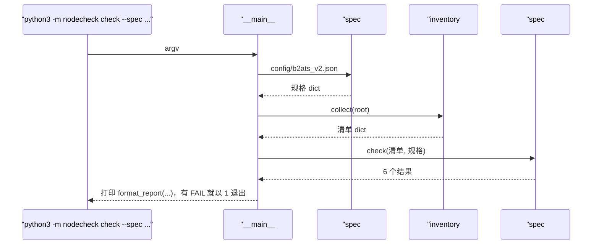
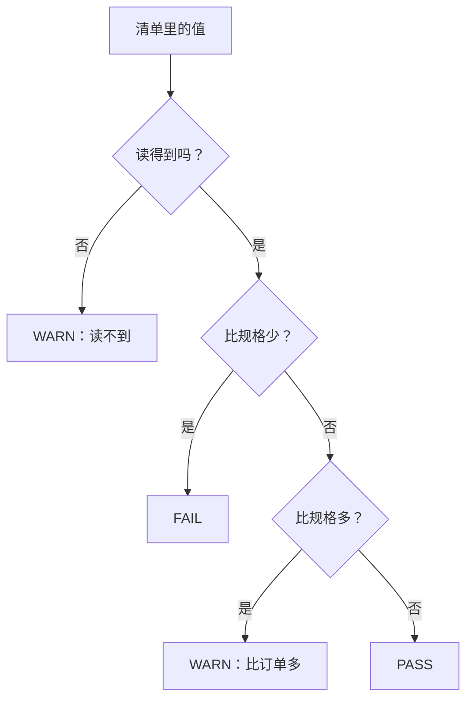

# 02 · 按机型规格验收一台机器

[English](02-spec-check.md)

> 步骤类型：**补缺的行为**（红 → 绿）。

## 1. 问题

清单说的是机器**有什么**。验收要的是一个结论：它和**订单**对得上吗？如果按"必须完全等于规格"去比，一台完全正常的 Azure VM 也会误报：1 GiB 只看到 0.82 GiB，SSD 自称机械盘。可要是比得太松，又会漏掉真问题，比如少了一个核、网卡掉线。

复现：`tests/test_spec.py`（20 个用例）。每个用例都从 node-1 的真实清单出发，只改一个字段。`check()` 不返回任何结果时，每个用例都失败，报 `assert None == 'PASS'`（或 `'FAIL'`、`'WARN'`）。

```
$ python3 -m nodecheck check --spec config/b2ats_v2.json --root tests/fixtures/node-1
Spec: Azure Standard_B2ats_v2
  cpu        2 logical CPUs               expected 2                                      PASS
  memory     0.82 GiB                     expected >= 0.80 GiB (1 GiB x 0.8)              PASS
  disk       sda 64 GiB                   expected >= 64 GiB                              PASS
  disk_type  not trusted here             expected ssd (not verifiable on this platform)  WARN
  nics       1 up (eth0)                  expected >= 1 up                                PASS
  os         Ubuntu 24.04.5 LTS           expected Ubuntu 24.04*                          PASS
Result: 0 FAIL, 1 WARN
$ echo $?
0
```

## 2. 是什么

**一个机型一张规格表。** 机房按 SKU（机型）验收：一整批机器用同一张表，不是每台一张。`config/b2ats_v2.json` 就是 `Standard_B2ats_v2` 的表：

| 键 | 值 | 为什么 |
|---|---|---|
| `cpu.logical_cpus` | 2 | Azure 卖的是 vCPU，一个 vCPU 就是一个硬件线程（这里是 1 核 × 2 线程） |
| `memory.gib`、`memory.min_ratio` | 1、0.8 | `MemTotal` 不含固件和内核预留，实测 0.82。比例写在规格里，大服务器可以用 0.95 |
| `disk.min_size_gib` | 64 | 我们开的系统盘 |
| `disk.type`、`disk.check_type` | "ssd"、false | Azure 的盘就算是 Premium SSD 也报 `rotational=1`；物理机上设成 `true` |
| `nics.min_up` | 1 | 只看在不在、连没连上；声称的速率（50 Gbit/s）不可信 |
| `os.prefix` | "Ubuntu 24.04" | 小版本（24.04.5）也算对 |

**三个等级**

| 等级 | 意思 | 例子 |
|---|---|---|
| FAIL | 比规格少，或者缺了。不能交货 | 2 核变 1 核；0.79 GiB；没有 64 GiB 的盘；网卡 down；Ubuntu 22.04 |
| WARN | 不算错，但要人看一眼 | 4 核（比订单多）；读不到；Azure 上验证不了盘类型 |
| PASS | 符合 | |

**退出码。** 有任何 FAIL，`check` 以 1 退出，否则以 0 退出。shell 把 0 当成功、非 0 当失败，所以 `for n in node-1 node-2; do ssh $n python3 -m nodecheck check ... || echo "$n failed"; done` 不用读报告就能挑出坏机器。

| 代码 | 做什么 |
|---|---|
| `spec#load_spec` | 读 JSON |
| `spec#check` | 跑 6 项检查，每项返回 `{"name", "status", "actual", "expected"}` |
| `spec#_compare_count` | "少了 FAIL、多了 WARN、读不到 WARN"这条规则，CPU 用它 |
| `spec#_check_memory` | `total_kib` 和 `gib × min_ratio` 比 |
| `spec#_check_disk`、`#_check_disk_type` | 至少一块盘 ≥ 最小容量；只在 `check_type` 打开时查类型；多块盘时最差的那块说了算 |
| `spec#_check_nics` | 数 `state == "up"` 的网卡；不看速率 |
| `spec#format_report`、`#has_failures` | 打印表格；决定退出码 |

## 3. 代码路径和判断规则





## 4. 为什么这样用

| 选择 | 为什么 | 替代方案和代价 |
|---|---|---|
| 🤖 一个机型一张规格，用 JSON | 和一批机器的验收方式一致；Python 3.10 自带 JSON | TOML 更好读，但 `tomllib` 3.11 才有（这台 Windows 是 3.10） |
| 🤖 FAIL = 少了 / 缺了，WARN = 多了 / 不知道 / 验证不了 | 比订单少就不能交货；"多了"或"不知道"要人看，不该直接拦下 | 把"多了"当 FAIL 会拦下好机器；把"不知道"当 PASS 会藏住问题 |
| 🤖 内存比例写在规格里，不写在代码里 | 小机器预留占比大（这里 18%），大服务器只有几个百分点 | 写死一个比例，总有一种机器会判错 |
| 🤖 Azure 上关掉盘类型检查 | 平台每块盘都报错的值 | 打开就每台都 FAIL：一个永远报警的检查，最后没人会看 |
| 🤖 这里不查网卡速率 | 驱动声称 50 Gbit/s，实测 4.84；跑分时再实测 | 查声称值只会给人虚假的安心 |
| 🤖 测试在真实清单上只改一个字段 | 每个用例都能看出是哪一处差别改变了判决 | 手写的清单会慢慢和采集器真正返回的格式对不上 |

## 5. 八股在这里

**结论**：没有要优化的地方。要判断的是**每条线画在哪**：抓得到真问题，又不乱报警。

| 八股 | 代码在哪 | 这里的判断 |
|---|---|---|
| 📗 TS-JS6 登上服务器先敲哪 5 条 | 整个 `check` | "第一眼"的自动化，而且直接给结论 |
| 📗 面经题型 1：CPU、内存怎么看规格 | `_check_cpu`、`_check_memory` | 逻辑 CPU 对 vCPU；MemTotal 带比例比 |
| 📗 DE-L内存1、XL-S4.1 MemTotal 和装了多少 | `_check_memory` | MemTotal 永远不等于装的大小，要带比例 |
| 📗 USE 方法：和正常值比 | `check` | 规格是硬件的"正常值"；第 4 步的 baseline 是性能的"正常值" |
| ➕ 按 SKU 验收 | `config/b2ats_v2.json` | 一个机型一张表 |
| ➕ 误报 | `disk.check_type`、网卡速率 | 永远报警的检查会被大家忽略。**什么时候打开**：物理机上，`rotational` 是准的 |
| ➕ 退出码 | `__main__#main`、`has_failures` | 0 / 1 让脚本和 CI 能根据结果行动 |

场景锚点（英文）：

- "A strict equality check would fail every Azure VM: memory shows 0.82 GiB of 1 GiB, and SSDs report as spinning disks. So the spec has a memory ratio and turns the disk-type check off on Azure."
- "Less than ordered is a FAIL. More than ordered, or a value I can't read, is a WARN for a person to look at."
- "The command exits non-zero on any FAIL, so a loop over a rack can pick out the bad nodes."

## 6. 面试追问链

1. **怎么确认一台服务器和订单一致？** 先采集清单，再和它所属机型的规格比。
2. **为什么不要求完全相等？** 有的值永远不会完全相等（MemTotal），有的值在某些平台上是错的（Azure 上的盘类型）。
3. **内存比例怎么定？** 要高于"真坏了"时剩下的比例。16 根内存条坏一根还剩 93.75%，0.8 根本抓不到，那种机器要用 0.95 左右。1 GiB 的 VM 预留就占了 18%，所以用 0.8。
4. **你的 FAIL 和 WARN 有什么区别？** FAIL 拦下交货（少了、缺了）。WARN 请人看一眼（多了、不知道、验证不了）。
5. **1000 台怎么跑？** 同一个规格文件，逐台跑（SSH 或装 agent），收集退出码和报告，列出所有 FAIL。

## 7. 英文说法

- "Each machine type has a spec file. The checker compares the inventory with it and gives PASS, WARN or FAIL for each item."
- "Less than ordered is a FAIL. More than ordered, or something I can't read, is a WARN."
- "Thresholds live in the spec, not the code. Memory needs a ratio because the kernel never sees all of it."
- "Checks that always fire get ignored, so I turned off disk type on Azure, where it's always wrong."

## 8. 资料

- `proc_meminfo(5)`：MemTotal 是 "physical RAM minus a few reserved bits and the kernel binary code" — https://man7.org/linux/man-pages/man5/proc_meminfo.5.html
- Microsoft Learn：Basv2 系列（这张规格的来源：2 vCPU、1 GiB）— https://learn.microsoft.com/azure/virtual-machines/sizes/general-purpose/basv2-series
- Python `sys.exit`：0 是成功，非 0 在 shell 看来是失败 — https://docs.python.org/3/library/sys.html#sys.exit
- Python `tomllib`（3.11 才加入，所以规格用 JSON）— https://docs.python.org/3/library/tomllib.html

## 9. 自测题

<details>
<summary>1. 订单写 "2 vCPU"，机器是 2 个逻辑 CPU、1 个物理核。PASS 还是 FAIL？</summary>

PASS。vCPU 是硬件线程，要和逻辑 CPU 比。和物理核比的话，这个机型的每台 Azure VM 都会 FAIL。
</details>

<details>
<summary>2. 结果已经打印出来了，为什么有 FAIL 时还要以 1 退出？</summary>

让脚本不用解析文字就能行动：批量跑很多台的循环、或者 CI 任务，看到非 0 就把这台标出来。
</details>

<details>
<summary>3.（真懂才答得出）一台物理服务器 512 GiB，16 根内存条，你照搬 min_ratio 0.8。坏了一根，抓得到吗？比例该设多少？</summary>

抓不到。16 根剩 15 根是 480 GiB，是 512 的 93.75%，远高于 0.8，会 PASS。比例要高于"坏一根"剩下的 0.9375，又要低于正常预留后能看到的比例（大服务器大约 97–98%，主要是内核给每个内存页记账用的 `struct page`），所以大约 0.95。比例必须按机型定，这就是它写在规格文件里的原因。
</details>

## 10. 预计回放时间

30 分钟。
