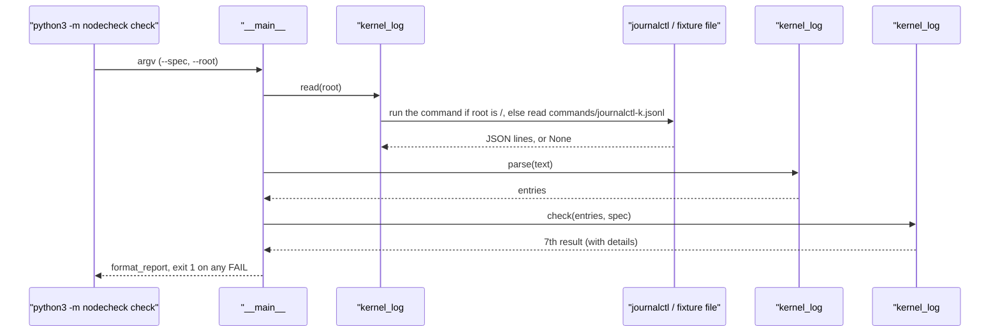
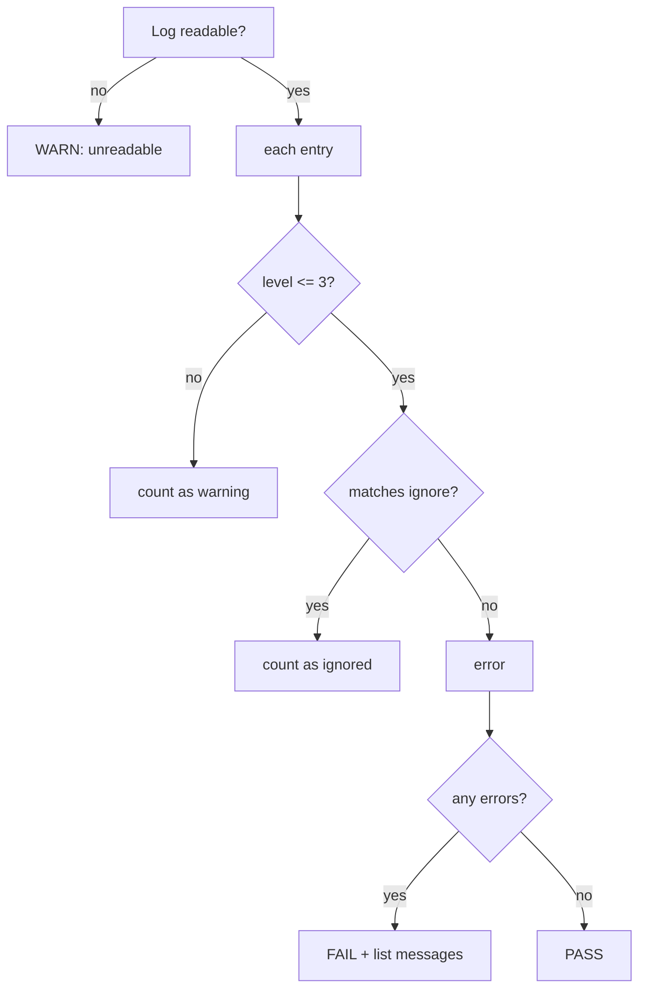

# 03 · Kernel log: has the kernel reported errors since boot?

[中文](03-kernel-log.zh-CN.md)

> Step type: **missing behaviour** (red → green).

## 1. The problem

The inventory and the spec only say what a machine **has**. Hardware can be present and still broken: disk I/O errors, the OOM killer, CPU hardware errors. The kernel logs all of these. Acceptance needs an answer to: "Has the kernel reported an error since this boot?"

The hard part: a **healthy** Azure VM logs 1 err and 9 warnings at boot (a missing virtual CD-ROM, no PCI bus, no CPU microcode, ...). If all of them counted, every good machine would fail.

Reproduced by `tests/test_kernel_log.py` (15 cases). The base data is node-1's real log; each case appends **one line** (copied from the real sr0 line, with a new `MESSAGE` and `PRIORITY`) and checks whether the verdict changes. While `kernel_log.py` was a stub, all 15 failed on assertions (`assert None == 'PASS'`, `assert 0 == 10`).

```
$ python3 -m nodecheck check --spec config/b2ats_v2.json --root tests/fixtures/node-1
  ...
  kernel_log 0 errors (1 ignored, 9 warnings)   expected none at priority <= 3, boot 11 Nov 05:39 UTC PASS
Result: 0 FAIL, 1 WARN

# the same log plus one OOM line:
  kernel_log 1 error (1 ignored, 9 warnings)    expected none at priority <= 3, boot 11 Nov 05:39 UTC FAIL
    Out of memory: Killed process 1234 (python3) total-vm:812345kB
Result: 1 FAIL, 1 WARN        # exit code 1
```

## 2. What it is

**Where kernel messages come from.** Kernel code (drivers, memory management, file systems) writes messages with `printk`. Each has a **level** and goes into a **ring buffer** in memory (fixed size, oldest entries overwritten when full, empty after a reboot).

```
kernel code printk / pr_err(...)
        │
        ▼
ring buffer (memory)
   ├── dmesg              reads the buffer directly
   └── journald (service) copies it to disk, /var/log/journal/
            └── journalctl -k   reads that copy
```

**Levels (syslog priority)**: 0 emerg, 1 alert, 2 crit, 3 err, 4 warning, 5 notice, 6 info, 7 debug. The level is **chosen by whoever wrote that `printk`** in the kernel source, for example:

| Message | Source | Level |
|---|---|---|
| `Out of memory: Killed process ...` | `mm/oom_kill.c`: `pr_err` | 3 |
| `I/O error, dev sda, sector ...` | `block/blk-mq.c`: `KERN_ERR` | 3 |
| `mce: [Hardware Error]: CPU 0: Machine Check ...` | `arch/x86/kernel/cpu/mce/core.c`: `pr_emerg` | 0 |
| `Machine check events logged` (just a notice) | same file: `pr_info` | 6 |
| `python3[1234]: segfault at ...` | `arch/x86/mm/fault.c`: `KERN_INFO` for normal processes | 6 |

**The command.**

```
journalctl -k -b -p warning -o json --no-pager
```

| Option | Meaning |
|---|---|
| `-k` | kernel messages only |
| `-b` | this boot only |
| `-p warning` | level 4 and worse (0–4) |
| `-o json` | one JSON object per line, with a numeric `PRIORITY` (the default text output has no level) |
| `--no-pager` | print everything, don't page |

**Two facts checked on the VMs** (`results/node-*/klog/env.txt`):
- Ubuntu sets `kernel.dmesg_restrict = 1`; `dmesg` as a normal user → `Operation not permitted`
- `azureuser` is in the `adm` group, so `journalctl` reads the whole system journal without sudo

| Code | What it does |
|---|---|
| `kernel_log#run` | runs `journalctl`; missing command, timeout or non-zero exit → `None` |
| `kernel_log#read` | runs the command when `root` is `/`; otherwise reads `commands/journalctl-k.jsonl` in the fixture |
| `kernel_log#parse` | one dict per line: `priority`, `message`, two timestamps; skips lines that aren't JSON; decodes `MESSAGE` given as a byte array |
| `kernel_log#boot_time` | boot = wall-clock time (`__REALTIME_TIMESTAMP`) − time since boot (`__MONOTONIC_TIMESTAMP`) |
| `kernel_log#check` | level 0–3 and not ignored → an error; errors FAIL, none PASS, unreadable WARN; the messages go in `details` |
| `spec#format_report` | prints `details` indented under their check (at most 5) |

New section in the spec (`config/b2ats_v2.json`):

```json
"kernel_log": {
  "max_priority": 3,
  "ignore": [
    {"pattern": "^/dev/sr0: Can't lookup blockdev$",
     "reason": "Logged at err during boot on both VMs: ... the VM has no sr0 device ..."}
  ]
}
```

## 3. Code path and decision rule





## 4. Why this way

| Choice | Why | Alternative and cost |
|---|---|---|
| 🤖 `journalctl -k`, not `dmesg` | `dmesg` needs root on Ubuntu; the journal has numeric levels and per-boot filtering | `sudo dmesg`: the tool needs root. `/var/log/kern.log`: needs rsyslog, no levels |
| 🤖 `-o json` | the level is in `PRIORITY`; the standard `json` module parses it | parsing text: no level in it, and the format changes with options |
| 🤖 this boot only (`-b`) | acceptance is about this run; the VMs stop every night, so this boot = today | last 24 h: crosses reboots and counts errors already fixed. Cost: a node up for 30 days carries 30 days of errors; add `--since` later |
| 🤖 0–3 are errors, warnings only counted | a healthy VM logs 9 warnings at boot, all noise | counting warnings: every node fails and nobody reads the check |
| 🤖 ignore list in the spec, each with a reason | a known harmless err (sr0) must pass, but on record | hard-coded: other machine types need code changes; no reason: nobody dares remove it later |
| 🤖 errors FAIL, not WARN | same as the spec check: an unexplained kernel error blocks handover; once explained, it goes on the ignore list | always WARN: looser, and easy to ignore |
| 🤖 unreadable is WARN, not PASS | not seeing errors isn't the same as having none | PASS: a permission problem would silently disable the check |
| 🤖 fixture in `commands/journalctl-k.jsonl`, read when `--root` points there | as in the inventory step, one `--root` decides which machine you are looking at | a separate `--kernel-log FILE`: easy to pair a fixture inventory with the local log by mistake |

**Limits (what it misses)**

The level answers "how urgent is this for the kernel", not "is this machine fit to hand over". So:
- **Real problems logged only as warnings are missed**, e.g. a NIC transmit timeout: the kernel resets the NIC, recovers, and logs a warning.
- **Problems that only show in numbers are missed**: one segfault is a program bug; many different programs segfaulting at random often means bad memory. Each line is only info.
- Next step: a **watch list** of patterns (`transmit queue timed out`, `segfault`) that give a WARN whatever the level.

## 5. Interview topics here

**Conclusion**: nothing to "optimise". What matters is **reading the right source** (works without root) and **drawing the line right** (real errors caught, noise not counted).

| Topic | Code | Judgement here |
|---|---|---|
| 📗 TS-RS13 where to look for boot errors | `kernel_log#read` | `dmesg` reads the buffer, `journalctl -k -b` the copy on disk; only the latter works without root on Ubuntu |
| 📗 DE-L排查1 where system logs live | `kernel_log#JOURNALCTL` | `/var/log/journal` (journald, binary); `/var/log/syslog`, `kern.log` are rsyslog text |
| 📗 USE 60-second checklist: `dmesg \| tail` | `kernel_log#check` | the same look, automated: err and worse, with an ignore list |
| 📗 field interviews: where to see errors | same | asked shallowly; "dmesg / journalctl -k, adm group on Ubuntu" is enough |
| 📗 XL-S4.3, DE-L内存3 OOM killer | test `oom-err` | OOM is `pr_err` (3): FAIL |
| 📗 TS-SS27 segfaults | test `segfault-info` | info (6): no FAIL, one segfault is the program's problem. **When it matters**: many programs segfaulting → suspect memory |
| ➕ the 8 syslog levels | `max_priority` | 0–3 count; the level is chosen by the `printk` author |
| ➕ `dmesg_restrict` | `kernel_log#read` | why not `dmesg` |
| ➕ ring buffer | — | fixed size, overwritten, cleared on reboot; journald keeps a copy |
| ➕ known noise on record | `kernel_log.ignore` | every exception has a reason |

Scenario anchors:
- "A healthy Azure VM logs one kernel error at boot, about a missing virtual CD-ROM. I put it on an ignore list in the spec, with the reason, so good machines don't fail."
- "I read the kernel log with journalctl, not dmesg. On Ubuntu, dmesg needs root, and the journal gives me a numeric priority per message."

## 6. Follow-up chain

1. **Where do you look for hardware problems on a server?** `dmesg` or `journalctl -k`; same kernel messages.
2. **What's the difference?** `dmesg` reads the in-memory ring buffer: overwritten, lost on reboot, root-only on Ubuntu. journald stores it on disk, filters by boot and level, and the `adm` group can read it.
3. **What counts as an error?** Syslog levels 0–3. The kernel developer picks the level in the code.
4. **Is the level reliable?** Mostly, but it is the kernel's view of urgency. A NIC timeout is only a warning; segfaults are info, yet many of them often mean bad memory. Hence the ignore list, and a watch list next.
5. **And on 1000 machines?** Same check on each, collect FAILs with their messages. A message on many nodes is probably platform noise (ignore list); one on a single node is worth a hardware look.

## 7. How to say it

- "The check reads this boot's kernel messages from the journal and counts anything at error level or worse."
- "Known harmless messages go on an ignore list in the spec, each with a reason. Everything else at error level fails the node, and the report prints the message."
- "If the log can't be read, it's a WARN, not a PASS. Not seeing errors isn't the same as having none."
- "The log level is the kernel's opinion of urgency, not a verdict on the machine. A NIC timeout is only a warning, so the next step would be a watch list."

## 8. Sources

- Kernel docs: printk levels (`KERN_EMERG` "0" … `KERN_DEBUG` "7", `pr_err` and friends) — https://docs.kernel.org/core-api/printk-basics.html
- `journalctl(1)`: `-k`, `-b`, `-p`, `-o json`; groups `adm`, `systemd-journal`, `wheel` can read the system journal — https://www.freedesktop.org/software/systemd/man/latest/journalctl.html
- Kernel docs: `dmesg_restrict` (when 1, `dmesg` needs `CAP_SYSLOG`) — https://docs.kernel.org/admin-guide/sysctl/kernel.html#dmesg-restrict
- systemd: journal JSON format (non-UTF-8 fields become number arrays) — https://systemd.io/JOURNAL_EXPORT_FORMATS/

## 9. Self-check

<details>
<summary>1. On Ubuntu, dmesg as a normal user says "Operation not permitted". Why? How do you read kernel messages without sudo?</summary>

`kernel.dmesg_restrict = 1`, so reading the buffer needs `CAP_SYSLOG`. Use `journalctl -k`: journald keeps the kernel messages and members of `adm` can read them.
</details>

<details>
<summary>2. node-1 has an err in its log. Why does it PASS?</summary>

It is `/dev/sr0: Can't lookup blockdev`: something at boot looks for a virtual CD-ROM, but this VM has no sr0 device. It is on the spec's ignore list with that reason. Empty the list and it fails (a test proves it).
</details>

<details>
<summary>3. (Only if you really get it) The log has 30 segfaults from different programs. What does the check say? What do you think?</summary>

PASS: segfaults are info (6), above 3. But many different programs crashing at random is a classic sign of bad memory, which no single line's level shows. Run a memory test (e.g. `memtester`; on bare metal also look at EDAC / MCE). The level is the kernel's opinion, not a verdict on the machine, which is why a watch list is the next step.
</details>

## 10. Replay time

30 minutes.
