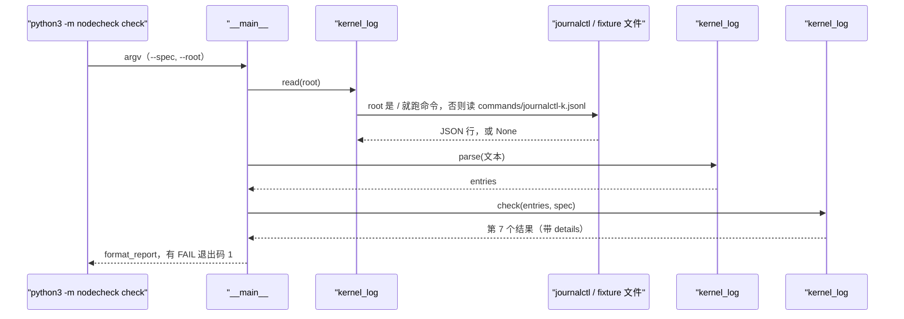
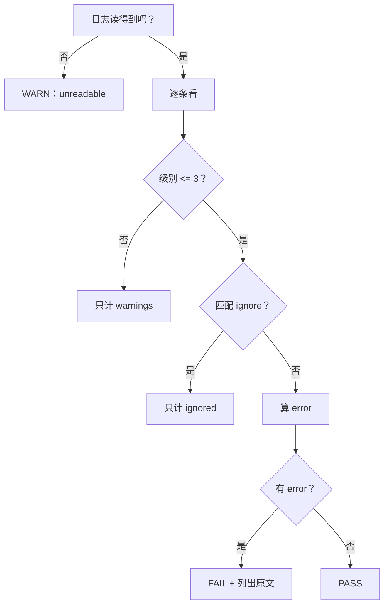

# 03 · 内核日志：开机以来内核报过错吗

[English](03-kernel-log.md)

> 步骤类型：**补缺的行为**（红 → 绿）。

## 1. 问题

清单和规格只说明机器**有什么**。硬件可能"在"但不正常：硬盘读写出错、内存不够把进程杀了、CPU 报硬件错误。这些内核都会写进日志。验收时要回答："这次开机以来，内核报过错吗？"

难点在于：一台**健康**的 Azure VM 开机时也会写 1 条 err、9 条 warning（虚拟光驱找不到、没有 PCI 总线、拿不到 CPU 微码……）。要是把它们都当错误，每台好机器都会 FAIL。

复现：`tests/test_kernel_log.py`（15 个用例）。基础数据是 node-1 的真实日志；每个用例往后加**一行**（从真实的 sr0 那行复制，只改 `MESSAGE` 和 `PRIORITY`），看判决变没变。`kernel_log.py` 还是空壳时，15 个全部是断言失败（`assert None == 'PASS'`、`assert 0 == 10`）。

```
$ python3 -m nodecheck check --spec config/b2ats_v2.json --root tests/fixtures/node-1
  ...
  kernel_log 0 errors (1 ignored, 9 warnings)   expected none at priority <= 3, boot 11 Nov 05:39 UTC PASS
Result: 0 FAIL, 1 WARN

# 同一份日志加一条 OOM：
  kernel_log 1 error (1 ignored, 9 warnings)    expected none at priority <= 3, boot 11 Nov 05:39 UTC FAIL
    Out of memory: Killed process 1234 (python3) total-vm:812345kB
Result: 1 FAIL, 1 WARN        # 退出码 1
```

## 2. 是什么

**内核日志从哪来。** 内核里的代码（驱动、内存管理、文件系统）用 `printk` 写消息，每条带一个**级别**，写进内存里的一块**环形缓冲区**（ring buffer：大小固定，写满就覆盖最旧的，重启就清空）。

```
内核代码 printk / pr_err(...)
        │
        ▼
环形缓冲区（内存）
   ├── dmesg              直接读缓冲区
   └── journald（服务）    抄到磁盘 /var/log/journal/
            └── journalctl -k   读这份副本
```

**级别（syslog priority）**：0 emerg、1 alert、2 crit、3 err、4 warning、5 notice、6 info、7 debug。级别是**写那行 `printk` 的内核开发者定的**，例如：

| 消息 | 源码 | 级别 |
|---|---|---|
| `Out of memory: Killed process ...` | `mm/oom_kill.c`：`pr_err` | 3 |
| `I/O error, dev sda, sector ...` | `block/blk-mq.c`：`KERN_ERR` | 3 |
| `mce: [Hardware Error]: CPU 0: Machine Check ...` | `arch/x86/kernel/cpu/mce/core.c`：`pr_emerg` | 0 |
| `Machine check events logged`（只是提示） | 同上：`pr_info` | 6 |
| `python3[1234]: segfault at ...` | `arch/x86/mm/fault.c`：普通进程用 `KERN_INFO` | 6 |

**读的命令。**

```
journalctl -k -b -p warning -o json --no-pager
```

| 参数 | 意思 |
|---|---|
| `-k` | 只要内核的消息 |
| `-b` | 只要本次开机的 |
| `-p warning` | 级别 4 及更严重（0–4） |
| `-o json` | 每行一个 JSON 对象；有数字级别 `PRIORITY`（默认的文本格式里没有级别） |
| `--no-pager` | 一次输出完，不分页 |

**两个在 VM 上验证过的事实**（`results/node-*/klog/env.txt`）：
- Ubuntu 默认 `kernel.dmesg_restrict = 1`，普通用户跑 `dmesg` → `Operation not permitted`
- `azureuser` 在 `adm` 组，`journalctl` 不用 sudo 就能读整个系统日志

| 代码 | 做什么 |
|---|---|
| `kernel_log#run` | 跑 `journalctl`；命令不存在、超时、退出码非 0 → `None` |
| `kernel_log#read` | `root` 是 `/` 就跑命令；否则读 fixture 里的 `commands/journalctl-k.jsonl` |
| `kernel_log#parse` | 每行一个 dict：`priority`、`message`、两个时间戳；不是 JSON 的行跳过；`MESSAGE` 是字节数组时还原成文字 |
| `kernel_log#boot_time` | 开机时刻 = 墙上时间（`__REALTIME_TIMESTAMP`）− 开机后经过的时间（`__MONOTONIC_TIMESTAMP`） |
| `kernel_log#check` | 0–3 级且不在 ignore 里 → 算错误；有错误 FAIL，没有 PASS，读不到 WARN；错误原文放进 `details` |
| `spec#format_report` | 有 `details` 就缩进打印在那一项下面（最多 5 条） |

规格里新加的一节（`config/b2ats_v2.json`）：

```json
"kernel_log": {
  "max_priority": 3,
  "ignore": [
    {"pattern": "^/dev/sr0: Can't lookup blockdev$",
     "reason": "Logged at err during boot on both VMs: ... the VM has no sr0 device ..."}
  ]
}
```

## 3. 代码路径和判断规则





## 4. 为什么这样用

| 选择 | 为什么 | 替代方案和代价 |
|---|---|---|
| 🤖 `journalctl -k`，不用 `dmesg` | Ubuntu 上 `dmesg` 要 root；journal 有数字级别、能按开机筛 | `sudo dmesg`：工具就得有 root；`/var/log/kern.log`：要装 rsyslog，没有级别 |
| 🤖 `-o json` | 级别在 `PRIORITY` 字段里；标准库 `json` 就能解析 | 解析文本：文本里没有级别，格式还随选项变 |
| 🤖 只看本次开机（`-b`） | 验收看"这次运行"的状态；VM 每晚关机，本次开机 = 当天 | 最近 24 小时：会跨过重启，把已解决的错误算进来。代价：开了 30 天的机器会带上 30 天的错误，以后加 `--since` |
| 🤖 0–3 级算错误，warning 只计数 | 健康 VM 开机就有 9 条 warning，全是噪音 | 连 warning 一起算：每台都 FAIL，这个检查就没人看了 |
| 🤖 ignore 清单写在规格里，每条带原因 | 已知无害的 err（sr0）要放过，但放过要有记录 | 写死在代码里：别的机型要改代码；不写原因：半年后没人敢删 |
| 🤖 有错误就 FAIL，不是 WARN | 和第 2 步一致：没查明的内核错误不能交货；查明了就进 ignore | 一律 WARN：更松，但容易被忽略 |
| 🤖 读不到是 WARN，不是 PASS | 没看到错误 ≠ 没有错误 | 当 PASS：权限一错，检查就悄悄失效 |
| 🤖 fixture 放在 `commands/journalctl-k.jsonl`，`--root` 指过去就读它 | 和第 1 步一样，一个 `--root` 决定"看哪台机器" | 单独加 `--kernel-log FILE`：fixture 清单配本机日志，容易拼错 |

**不足（知道它漏什么）**

级别回答的是"对内核来说多紧急"，不是"这台机器能不能交付"。所以：
- **内核只记成 warning 的真问题会漏**：比如网卡发送卡住，内核重置网卡后自己恢复了，只记 warning。
- **"很多条加起来才是问题"会漏**：一次段错误是程序的 bug；很多不同程序随机段错误，往往是内存坏了。单看每条都是 info。
- 下一步可以加**关注清单**：消息匹配某些关键词（`transmit queue timed out`、`segfault`）就 WARN，不管级别。

## 5. 八股在这里

**结论**：没有要"优化"的地方。关键是**读对来源**（不用 root 也读得到）和**画对线**（抓真错误，不被噪音淹没）。

| 八股 | 代码在哪 | 这里的判断 |
|---|---|---|
| 📗 TS-RS13 开机报错去哪看 | `kernel_log#read` | `dmesg` 读缓冲区，`journalctl -k -b` 读磁盘上的副本；Ubuntu 上普通用户只能用后者 |
| 📗 DE-L排查1 系统日志在哪 | `kernel_log#JOURNALCTL` | `/var/log/journal`（journald，二进制）；`/var/log/syslog`、`kern.log` 是 rsyslog 写的文本 |
| 📗 USE 60 秒：`dmesg \| tail` | `kernel_log#check` | 同一个动作的自动版：只看 err 及以上，并且有 ignore |
| 📗 面经题型 3：错误信息在哪看 | 同上 | 问得浅，答出"dmesg / journalctl -k，Ubuntu 要 adm 组"就够 |
| 📗 XL-S4.3、DE-L内存3 OOM killer | 测试 `oom-err` | OOM 是 `pr_err`（3），会 FAIL |
| 📗 TS-SS27 段错误怎么查 | 测试 `segfault-info` | 段错误是 info（6），不 FAIL：一次段错误是程序的事。**什么时候要管**：很多程序都在段错误 → 怀疑内存 |
| ➕ syslog 8 个级别 | `max_priority` | 0–3 算错误；级别是写 `printk` 的人定的 |
| ➕ `dmesg_restrict` | `kernel_log#read` | 为什么不用 `dmesg` |
| ➕ 环形缓冲区 | — | 固定大小、会覆盖、重启清空；journald 把它存下来 |
| ➕ 已知噪音要有记录 | `kernel_log.ignore` | 每条豁免都带原因 |

场景锚点（英文）：
- "A healthy Azure VM logs one kernel error at boot, about a missing virtual CD-ROM. I put it on an ignore list in the spec, with the reason, so good machines don't fail."
- "I read the kernel log with journalctl, not dmesg. On Ubuntu, dmesg needs root, and the journal gives me a numeric priority per message."

## 6. 面试追问链

1. **服务器有没有硬件问题，日志去哪看？** `dmesg` 或 `journalctl -k`；它们看的是同一批内核消息。
2. **两者有什么区别？** `dmesg` 读内存里的环形缓冲区：会被覆盖、重启就没了，Ubuntu 上要 root。journald 把它存到磁盘，能按开机、按级别筛，`adm` 组就能读。
3. **什么算错误？** syslog 级别 0–3。级别是内核开发者写代码时定的。
4. **级别可靠吗？** 大体可靠，但它说的是"对内核多紧急"。网卡超时只记 warning；段错误是 info，可大量段错误往往是内存坏了。所以加了 ignore，下一步是关注清单。
5. **1000 台机器怎么办？** 每台跑同一个检查，把 FAIL 和原文收集起来；同一条消息在很多台上出现，多半是平台噪音（进 ignore），只在一台上出现才要查硬件。

## 7. 英文说法

- "The check reads this boot's kernel messages from the journal and counts anything at error level or worse."
- "Known harmless messages go on an ignore list in the spec, each with a reason. Everything else at error level fails the node, and the report prints the message."
- "If the log can't be read, it's a WARN, not a PASS. Not seeing errors isn't the same as having none."
- "The log level is the kernel's opinion of urgency, not a verdict on the machine. A NIC timeout is only a warning, so the next step would be a watch list."

## 8. 资料

- 内核文档：printk 的级别（`KERN_EMERG` "0" … `KERN_DEBUG` "7"，`pr_err` 等）— https://docs.kernel.org/core-api/printk-basics.html
- `journalctl(1)`：`-k`、`-b`、`-p`、`-o json`；`adm`、`systemd-journal`、`wheel` 组能读系统日志 — https://www.freedesktop.org/software/systemd/man/latest/journalctl.html
- 内核文档：`dmesg_restrict`（设成 1 时要 `CAP_SYSLOG` 才能用 `dmesg`）— https://docs.kernel.org/admin-guide/sysctl/kernel.html#dmesg-restrict
- systemd：journal 的 JSON 格式（非 UTF-8 的字段写成数字数组）— https://systemd.io/JOURNAL_EXPORT_FORMATS/

## 9. 自测题

<details>
<summary>1. 普通用户在 Ubuntu 上跑 dmesg 报 Operation not permitted，为什么？不用 sudo 怎么看内核日志？</summary>

`kernel.dmesg_restrict = 1`，读缓冲区要 `CAP_SYSLOG`。用 `journalctl -k`：journald 把内核消息存进了 journal，`adm` 组的用户能读。
</details>

<details>
<summary>2. 为什么 node-1 有一条 err 却判 PASS？</summary>

那条是 `/dev/sr0: Can't lookup blockdev`：开机时有程序找虚拟光驱，可这台 VM 没有 sr0 设备。它在规格的 ignore 清单里，带着原因。把清单清空，它就 FAIL（有测试证明）。
</details>

<details>
<summary>3.（真懂才答得出）日志里出现了 30 条来自不同程序的 segfault，这个检查判什么？你会怎么想？</summary>

判 PASS：segfault 是 info（6），不到 3。但很多不同程序随机段错误是内存坏了的典型迹象，单看每条级别看不出来。应该跑内存测试（比如 `memtester`，物理机上看 EDAC / MCE）。这就是"级别是内核的看法，不是对机器的判决"，也是下一步要加关注清单的原因。
</details>

## 10. 预计回放时间

30 分钟。
