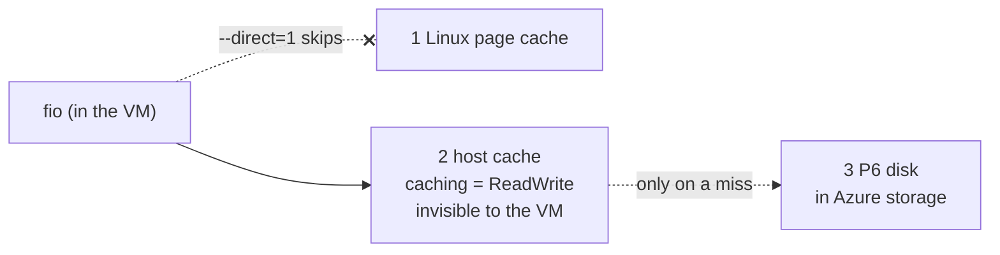
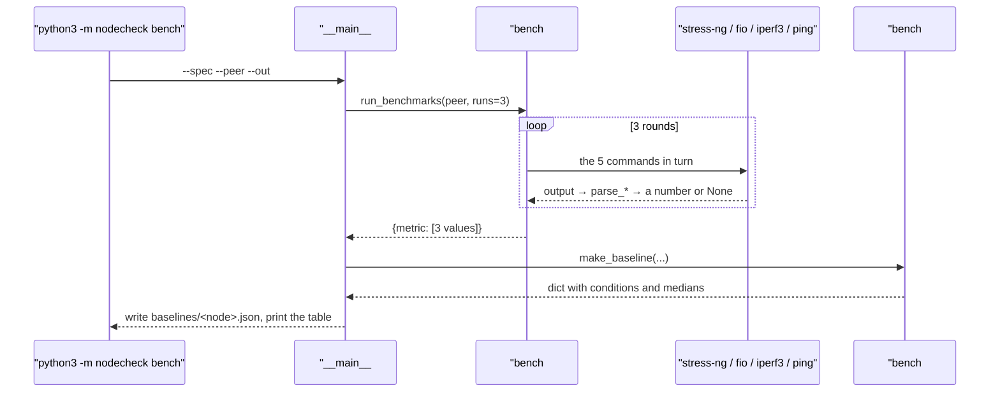

# 04 · Benchmarks and a baseline: a number means little without its conditions

[中文](04-benchmark-baseline.zh-CN.md)

> Step type: **missing behaviour** (red → green).

## 1. The problem

Inventory, spec and kernel log say whether a machine is **complete and error-free**, not whether it is **fast**. A NIC can be `up` with no errors and still deliver half its usual bandwidth. To notice that you need to know what normal is: a **baseline** to compare new measurements with (next step).

The hard part is that benchmark numbers lie easily: you may be timing a cache, not the disk; one run may be slowed by someone else; changed parameters make runs incomparable; and the cloud platform may be throttling you.

Reproduced by `tests/test_bench.py` (15 cases). Parsers are tested on real output captured on both VMs (`tests/fixtures/node-*/bench/`); the benchmark loop is tested with a **fake runner** that returns that output, with CPU results of 2336 / 1100 / 2300 (the middle run plays a noisy neighbour). While `bench.py` was a stub, 11 cases failed on assertions; the 4 that expect `None` from a failed tool already passed.

```
$ python3 -m nodecheck bench --spec config/b2ats_v2.json --peer 172.16.0.5 --out baselines/node-1.json
run 1/3 ...
run 2/3 ...
run 3/3 ...
Baseline for node-1 (Azure Standard_B2ats_v2), median of 3 runs
cpu_bogo_ops_per_s     <median> bogo ops/s  runs: ...
disk_randread_iops     ...      IOPS        runs: ...
disk_seqread_mb_per_s  ...      MB/s        runs: ...
net_gbit_per_s         ...      Gbit/s      runs: ...
net_latency_ms         ...      ms          runs: ...
Saved to baselines/node-1.json
```

## 2. What it is

**Five numbers**

| Metric | Tool and options | What it measures |
|---|---|---|
| `cpu_bogo_ops_per_s` | `stress-ng --cpu 2 --timeout 20s --metrics-brief` | 2 workers (= 2 vCPUs) computing for 20 s; "bogo" (bogus) ops per second. Only comparable with the **same tool and method**, not an absolute score across machine types |
| `disk_randread_iops` | `fio` 4k random read, `--iodepth=32`, 20 s | small reads per second (IOPS): what databases care about |
| `disk_seqread_mb_per_s` | `fio` 1M sequential read, `--iodepth=8`, 20 s | MB per second: large files, backups |
| `net_gbit_per_s` | `iperf3 -c peer -t 10 -J` | what the **peer received** in 10 s (not what was sent) |
| `net_latency_ms` | `ping -c 20 -i 0.2 peer` | average round trip of a small packet; the fault drills need it, because bandwidth and latency are different things |

**fio options**
| Option | Meaning |
|---|---|
| `--direct=1` | open with `O_DIRECT`, bypassing Linux's page cache (otherwise you time RAM) |
| `--ioengine=libaio` + `--iodepth=32` | keep 32 requests in flight, like a busy server; SSDs need concurrency to show their speed |
| `--time_based --runtime=20` | run for the full 20 s, not until the file has been read once |
| `--unlink=1` | delete the test file afterwards |

**What the disk numbers measure: two layers of cache**



4k random reads gave **9,400 IOPS**, while a P6 disk tops out at 3,500 (bursting). The Azure instance metadata service (IMDS), queried from inside the VM, says `osDisk.caching = "ReadWrite"`. `fio` writes its 256 MB file and then reads it, so the whole file sits in the host cache, and that is what gets measured.

**B-series CPU credits**: B2ats_v2 has a base CPU of **20%**. Below that it banks credits (24 per hour, max 576); above it spends them; when they run out it is throttled back to 20%. During the benchmark both vCPUs ran at 100% (`usr time 39.9 s / 20 s`), so these are **burst** numbers.

| Code | What it does |
|---|---|
| `bench#COMMANDS` | the 5 commands and units, fixed; `{peer}` becomes the peer's IP |
| `bench#run` | runs a command; missing, timeout or non-zero exit → `None` |
| `bench#parse_stress_ng`, `#parse_fio`, `#parse_iperf3`, `#parse_ping` | one number from the output; unparseable → `None` |
| `bench#median` | median of the runs that worked; all failed → `None` |
| `bench#run_benchmarks` | N rounds, the 5 tools **interleaved** in each; `runner` can be replaced by a fake |
| `bench#make_baseline` | node, time, exact commands, the spec's notes, every run, the median |
| `__main__#main` (`bench`) | saves the file, prints the table; exit 1 if a metric has no value at all |

## 3. Code path



## 4. Why this way

| Choice | Why | Alternative and cost |
|---|---|---|
| 🤖 options fixed in code and saved in the baseline | only the same method is comparable; the file records the exact commands | configurable options: flexible, and easy to change the method without noticing |
| 🤖 median of 3 | one slow run doesn't matter (2336 / 1100 / 2300 → 2300; the mean is 1912) | mean: pulled by one outlier. One run: an outlier becomes "normal" |
| 🤖 tools interleaved per round | a slow minute hits one run of each tool, which the median absorbs | 3× CPU then 3× fio: a slow minute can spoil two runs of the same tool |
| 🤖 `--direct=1` | skips Linux's cache | without it you measure RAM, GB/s, meaningless |
| 🤖 host cache not bypassed, written in the notes | the baseline is for **comparison**; same conditions, still useful. A separate uncached data disk costs time and money | extra data disk with `caching=None`: measures the disk itself (~240 / 3,500 IOPS) |
| 🤖 no memory benchmark | stressing memory on a 1 GiB VM easily triggers the OOM killer | `stress-ng --vm`, with careful sizing |
| 🤖 iperf3 "received" | sent data can be lost on the way | sender side: slightly optimistic |
| 🤖 one baseline per node | the next step compares "this node now vs this node when healthy" | one per machine type: right for accepting new nodes, but needs data from a set of healthy nodes first |
| 🤖 exit 1 if a metric has no value | e.g. no iperf3 server on the peer: the baseline is incomplete and shouldn't pass quietly | exit 0 with half a file: the gap shows up later, during a comparison |

**Limits**: the host cache makes disk numbers ~3× faster than the disk, and could hide a failing disk; with no CPU credits the score drops to about a fifth, which looks like a fault. Both are written in the baseline's `conditions.notes` for the comparison step.

## 5. Interview topics here

**Conclusion**: no code to "optimise". The work here is the **method**: numbers that can be trusted and compared.

| Topic | Code | Judgement here |
|---|---|---|
| 📗 TS-SS7 tuning principles: baseline first | `bench#make_baseline` | no baseline, no "how much worse"; and it must carry its method |
| 📗 TS-SN19 testing storage: repeat, avoid caches | `--direct=1`, `runs: 3` | both done; the cloud's host cache can't be avoided, only recorded |
| 📗 XL-S7.2 page cache | `--direct=1` | `O_DIRECT` skips the **local** page cache only. **When not to**: if you want what the application really experiences, go through the cache |
| 📗 XL-S2.2 disk vs memory speed | what happens without `--direct=1` | you time memory, orders of magnitude off |
| 📗 TS-SS32 disk bottleneck symptoms | `disk_randread_iops` | IOPS and MB/s are different dimensions; small random I/O is about IOPS |
| 📗 XL-S10.1 network metrics | `net_gbit_per_s`, `net_latency_ms` | bandwidth and latency measured separately; the latency drill relies on it |
| 📗 DE-N42 what affects network performance | `network` note | the size caps at 6,250 Mbps; one TCP stream gets ~4.9 Gbit/s |
| 📗 USE "averages hide things" | `bench#median` | median |
| ➕ noisy neighbours | `bench#median`, interleaving | shared hosts; single runs aren't reliable |
| ➕ B-series CPU credits | `cpu` note | burst score; out of credits looks like "-80%" |
| ➕ host cache | `disk` note, checked with IMDS | `O_DIRECT` can't reach outside the VM |
| ➕ bogo ops | `parse_stress_ng` | same tool and method only, not an absolute score |

Scenario anchors:
- "I got 9,400 IOPS from a disk rated at 3,500. The instance metadata showed host caching ReadWrite: direct I/O skips the guest's cache, not the host's. So the baseline records that condition."
- "Each benchmark runs three times and I keep the median, so one slow run from a noisy neighbour doesn't become the baseline."

## 6. Follow-up chain

1. **How do you baseline a server's performance?** One or two metrics each for CPU, disk and network, a fixed method, several runs, the median, stored together with the method.
2. **Why the median, not the mean?** One outlier moves the mean; the median only looks at the middle.
3. **What matters when testing a disk?** Bypass caches (`O_DIRECT`), run long enough, use concurrency (iodepth); in the cloud, know about host caching and bursting.
4. **Your numbers beat the disk's spec. Why?** The OS disk has host read/write caching and the test file is small, so it's all cached. To test the disk itself, use a data disk with `caching=None`, or a file much larger than the cache.
5. **Other cloud benchmarking traps?** CPU credits on burstable sizes, disk burst credits (30 minutes), noisy neighbours. Record the conditions and compare like with like.

## 7. How to say it

- "Benchmarks are only useful if they're measured the same way every time, so the commands are fixed and saved in the baseline file."
- "Each one runs three times, interleaved, and I keep the median."
- "On a burstable VM, the CPU score is a burst score. If the credits run out, it drops to about a fifth. That would look like a fault, so it's written in the baseline's notes."

## 8. Sources

- Microsoft Learn: Basv2 series (B2ats_v2: 20% base CPU, credits, 6,250 Mbps, disk limits) — https://learn.microsoft.com/azure/virtual-machines/sizes/general-purpose/basv2-series
- Microsoft Learn: B-series CPU credit model — https://learn.microsoft.com/azure/virtual-machines/b-series-cpu-credit-model/b-series-cpu-credit-model
- Microsoft Learn: managed disk bursting (credit-based up to P20, up to 30 minutes) — https://learn.microsoft.com/azure/virtual-machines/disk-bursting
- Xiaolin (Chinese): page cache and direct I/O — https://xiaolincoding.com/os/6_file_system/pagecache.html

## 9. Self-check

<details>
<summary>1. Three CPU runs give 2336, 1100 and 2300. What goes in the baseline, and why?</summary>

2300, the median. The mean, 1912, is dragged down by the middle run (probably a neighbour taking CPU).
</details>

<details>
<summary>2. What happens to fio without --direct=1?</summary>

Reads and writes go through Linux's page cache, so you measure memory (GB/s), not the disk.
</details>

<details>
<summary>3. (Only if you really get it) A P6 disk is rated at 3,500 IOPS at most, and you measured 9,400 with --direct=1. Why? How would you measure the disk itself?</summary>

`--direct=1` only bypasses the cache inside the VM. Azure OS disks have host caching (`caching=ReadWrite`) outside the VM, and fio's freshly written 256 MB file is entirely in it. To measure the disk: a data disk with `caching=None`, or a test file much larger than the host cache. Also, P6 normally does ~240 IOPS; 3,500 is burst, for up to 30 minutes.
</details>

## 10. Replay time

30 minutes.
