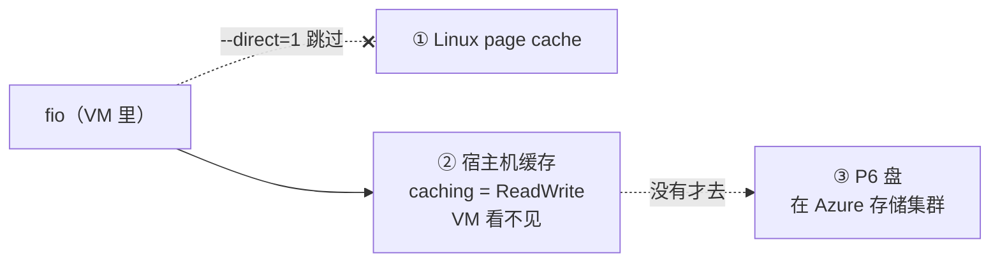
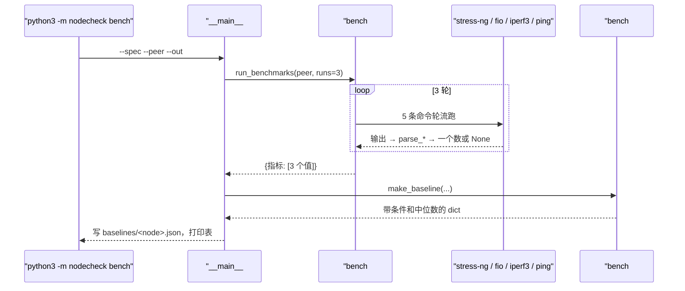

# 04 · 跑分和 baseline：一个数字要带着条件才有意义

[English](04-benchmark-baseline.md)

> 步骤类型：**补缺的行为**（红 → 绿）。

## 1. 问题

清单、规格、内核日志说明机器**齐不齐、有没有报错**，但说不了它**快不快**。一块网卡可以 `up`、没有报错，却只跑出平时一半的带宽。要发现这种问题，得先知道"正常是多快"，也就是 **baseline**（基线），以后拿新测的数和它比（第 5 步）。

难点是跑分数字很容易骗人：测到的可能是缓存而不是盘；可能碰上一次被别人拖慢；参数变了前后就对不上；云平台还可能在限速。

复现：`tests/test_bench.py`（15 个用例）。解析器测的是两台 VM 上抓的真实输出（`tests/fixtures/node-*/bench/`）；跑分流程用一个**假的 runner**测：它收到命令就回真实输出，CPU 三次给 2336 / 1100 / 2300（中间那次模拟"吵闹的邻居"）。`bench.py` 是空壳时 11 个断言失败；另外 4 个"工具失败时返回 None"的测试空壳本来就过。

```
$ python3 -m nodecheck bench --spec config/b2ats_v2.json --peer 172.16.0.5 --out baselines/node-1.json
run 1/3 ...
run 2/3 ...
run 3/3 ...
Baseline for node-1 (Azure Standard_B2ats_v2), median of 3 runs
cpu_bogo_ops_per_s     <中位数> bogo ops/s  runs: ...
disk_randread_iops     ...      IOPS        runs: ...
disk_seqread_mb_per_s  ...      MB/s        runs: ...
net_gbit_per_s         ...      Gbit/s      runs: ...
net_latency_ms         ...      ms          runs: ...
Saved to baselines/node-1.json
```

## 2. 是什么

**五个数，各测什么**

| 指标 | 工具和参数 | 测的是什么 |
|---|---|---|
| `cpu_bogo_ops_per_s` | `stress-ng --cpu 2 --timeout 20s --metrics-brief` | 2 个 worker（= 2 个 vCPU）反复算题 20 秒，每秒做了多少次"bogo op"。bogo = bogus，只能和**同一个工具、同一种算法**的结果比，不能跨机型当绝对分数 |
| `disk_randread_iops` | `fio` 4k 随机读，`--iodepth=32`，20 秒 | 每秒读几次小块（IOPS）：数据库这类负载看它 |
| `disk_seqread_mb_per_s` | `fio` 1M 顺序读，`--iodepth=8`，20 秒 | 每秒读多少 MB：大文件、备份看它 |
| `net_gbit_per_s` | `iperf3 -c 对方 -t 10 -J` | 10 秒内**对方实际收到**多少（不是发了多少） |
| `net_latency_ms` | `ping -c 20 -i 0.2 对方` | 一个小包来回的平均时间。第 6 步要用：带宽和延迟是两回事 |

**`fio` 几个参数**
| 参数 | 意思 |
|---|---|
| `--direct=1` | 用 `O_DIRECT` 打开文件，绕开 Linux 的 page cache（内存里的缓存），不然测的是内存 |
| `--ioengine=libaio` + `--iodepth=32` | 一次挂 32 个请求在路上，模拟繁忙的服务器；SSD 要并发才能跑出能力 |
| `--time_based --runtime=20` | 跑满 20 秒，不是读完文件就停 |
| `--unlink=1` | 跑完删掉测试文件 |

**测到的到底是什么：两层缓存**



实测 4k 随机读 **9,400 IOPS**，而 P6 盘自己最多 3,500（突发）。在 VM 里查 Azure 实例元数据服务（IMDS）：`osDisk.caching = "ReadWrite"`。`fio` 先写 256 MB 测试文件再读，整个文件都在宿主机缓存里，所以测到的是第 ② 层。

**Azure B 系列的 CPU 积分**：B2ats_v2 基础 CPU 只有 **20%**；低于 20% 时攒积分（每小时 24 分，最多 576），高于时花积分，花完就被压回 20%。跑分时两个 vCPU 都是 100%（`usr time 39.9 s / 20 s`），测到的是**突发状态**。

| 代码 | 做什么 |
|---|---|
| `bench#COMMANDS` | 5 条命令和单位，写死；`{peer}` 换成对方 IP |
| `bench#run` | 跑命令；不存在、超时、退出码非 0 → `None` |
| `bench#parse_stress_ng`、`#parse_fio`、`#parse_iperf3`、`#parse_ping` | 从输出里取一个数；解析不了 → `None` |
| `bench#median` | 去掉失败的再取中位数；全失败 → `None` |
| `bench#run_benchmarks` | 跑 N 轮，每轮 5 个工具**轮流**跑；`runner` 可以换成假的 |
| `bench#make_baseline` | 组成 baseline：机器、时间、命令原文、规格里的备注、每次的值、中位数 |
| `__main__#main`（`bench`） | 存文件、打印表；有指标一个值都没有 → 退出码 1 |

## 3. 代码路径



## 4. 为什么这样用

| 选择 | 为什么 | 替代方案和代价 |
|---|---|---|
| 🤖 参数写死在代码里，并存进 baseline | 只有同样的测法才能比；文件里有命令原文，以后能核对 | 参数可配置：灵活，但很容易前后测法不同还不知道 |
| 🤖 3 次取中位数 | 一次被邻居拖慢不影响结果（2336 / 1100 / 2300 → 2300；平均会是 1912） | 平均值：被一次异常拖走。只跑 1 次：碰到异常就把它当成"正常" |
| 🤖 每轮 5 个工具轮流跑 | 一阵慢只影响每个工具的一次，中位数能挡住 | 先 CPU 跑 3 次再 fio 跑 3 次：一阵慢可能连着毁掉同一个工具的 2 次 |
| 🤖 `--direct=1` | 绕开 Linux 缓存 | 不加：测的是内存，几 GB/s，毫无意义 |
| 🤖 宿主机缓存不绕开，写进备注 | baseline 是拿来**比**的，条件不变就有用；另开无缓存数据盘要花时间和钱 | 另加数据盘、`caching=None`：能测到盘本身（约 240 / 3500 IOPS） |
| 🤖 不测内存 | 1 GiB 的机器压内存容易触发 OOM | `stress-ng --vm`：要小心控制大小 |
| 🤖 iperf3 看"收到"的 | 发出去的可能在路上丢掉 | 看 sender：会略微偏高 |
| 🤖 按每台机器存 | 第 5 步比"这台机器现在 vs 它健康时" | 按机型存一份"标准"：适合验收新机器，但要先有一批健康机器的数据 |
| 🤖 有指标一个值都没有 → 退出码 1 | 比如对方没开 iperf3：这份 baseline 不完整，不该悄悄当成功 | 写一半也返回 0：以后比较时才发现缺数据 |

**不足**：宿主机缓存让盘的数字比盘本身快近 3 倍，盘真坏了也可能被缓存挡住；CPU 积分用完时分数掉到约 1/5，看起来像故障。两条都写在 baseline 的 `conditions.notes` 里，第 5 步比较时要考虑。

## 5. 八股在这里

**结论**：没有要"优化"的代码。这一步的功夫在**测法**：让数字可信、可比。

| 八股 | 代码在哪 | 这里的判断 |
|---|---|---|
| 📗 TS-SS7 调优原则：先测基线 | `bench#make_baseline` | 先有 baseline 才能说"变差了多少"；baseline 要带测法 |
| 📗 TS-SN19 怎么测存储：多跑、排除缓存 | `--direct=1`、`runs: 3` | 都做了；但云上还有一层宿主机缓存排除不了，只能记下来 |
| 📗 XL-S7.2 page cache | `--direct=1` | `O_DIRECT` 只绕开**本机** page cache。**什么时候不用**：想测"应用实际体验"时就该走缓存 |
| 📗 XL-S2.2 磁盘比内存慢多少 | 不加 `--direct=1` 的后果 | 测到内存速度，差几个数量级 |
| 📗 TS-SS32 磁盘瓶颈症状 | `disk_randread_iops` | IOPS 和 MB/s 是两个维度；小块随机看 IOPS |
| 📗 XL-S10.1 网络指标 | `net_gbit_per_s`、`net_latency_ms` | 带宽和延迟分开测；第 6 步就靠这两个分开 |
| 📗 DE-N42 什么影响网络性能 | 备注 `network` | VM 规格上限 6,250 Mbps；单条 TCP 实测约 4.9 Gbit/s |
| 📗 USE"平均值会骗人" | `bench#median` | 用中位数 |
| ➕ 吵闹的邻居 | `bench#median`、轮流跑 | 云上共享物理机，单次结果不可靠 |
| ➕ B 系列 CPU 积分 | 备注 `cpu` | 测的是突发；积分用完像"掉了 80%" |
| ➕ 宿主机缓存 | 备注 `disk`，IMDS 查证 | `O_DIRECT` 管不到 VM 外面 |
| ➕ bogo ops | `parse_stress_ng` | 只能同工具同算法比，不是绝对分数 |

场景锚点（英文）：
- "I got 9,400 IOPS from a disk rated at 3,500. The instance metadata showed host caching ReadWrite: direct I/O skips the guest's cache, not the host's. So the baseline records that condition."
- "Each benchmark runs three times and I keep the median, so one slow run from a noisy neighbour doesn't become the baseline."

## 6. 面试追问链

1. **怎么给一台服务器建性能基线？** CPU、盘、网络各一两个指标，固定测法，跑多次取中位数，连同测法一起存下来。
2. **为什么中位数，不用平均？** 单次异常会拖动平均值；中位数只看中间那个。
3. **测盘要注意什么？** 绕开缓存（`O_DIRECT`）、时间够长、要有并发（iodepth）；云上还要知道有没有宿主机缓存、有没有突发。
4. **你测到的数比盘的规格还高，怎么解释？** 查到系统盘开着宿主机读写缓存；测试文件小，全在缓存里。要测盘本身，就加一块 `caching=None` 的数据盘，或者测试文件远大于缓存。
5. **云上跑分还有什么坑？** 突发型实例的 CPU 积分；盘的突发积分（30 分钟）；吵闹的邻居。跑分要记录条件，比较时条件要一致。

## 7. 英文说法

- "Benchmarks are only useful if they're measured the same way every time, so the commands are fixed and saved in the baseline file."
- "Each one runs three times, interleaved, and I keep the median."
- "On a burstable VM, the CPU score is a burst score. If the credits run out, it drops to about a fifth. That would look like a fault, so it's written in the baseline's notes."

## 8. 资料

- Microsoft Learn：Basv2 系列（B2ats_v2：基础 CPU 20%、积分、网络 6,250 Mbps、盘的上限）— https://learn.microsoft.com/azure/virtual-machines/sizes/general-purpose/basv2-series
- Microsoft Learn：B 系列 CPU 积分模型 — https://learn.microsoft.com/azure/virtual-machines/b-series-cpu-credit-model/b-series-cpu-credit-model
- Microsoft Learn：托管盘突发（P20 及以下按积分突发，最多 30 分钟）— https://learn.microsoft.com/azure/virtual-machines/disk-bursting
- 小林：page cache 和直接 I/O — https://xiaolincoding.com/os/6_file_system/pagecache.html

## 9. 自测题

<details>
<summary>1. 三次 CPU 跑分是 2336、1100、2300，baseline 存多少？为什么？</summary>

2300（中位数）。平均是 1912，被中间那次（多半是邻居抢 CPU）拖下来了。
</details>

<details>
<summary>2. fio 不加 --direct=1 会怎样？</summary>

读写走 Linux 的 page cache，测到的是内存速度（GB/s 级），不是盘。
</details>

<details>
<summary>3.（真懂才答得出）P6 盘规格最多 3,500 IOPS，你测到 9,400。加了 --direct=1 为什么还这么快？怎么才能测到盘本身？</summary>

`--direct=1` 只绕开 VM 里 Linux 的缓存。Azure 系统盘默认开着宿主机缓存（`caching=ReadWrite`），在 VM 外面；`fio` 刚写的 256 MB 文件全在里面。要测盘本身：加一块 `caching=None` 的数据盘来测，或者测试文件远大于宿主机缓存。另外 P6 平时只有约 240 IOPS，3,500 是突发，最多 30 分钟。
</details>

## 10. 预计回放时间

30 分钟。
