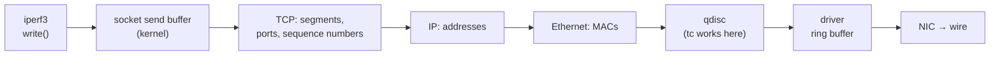
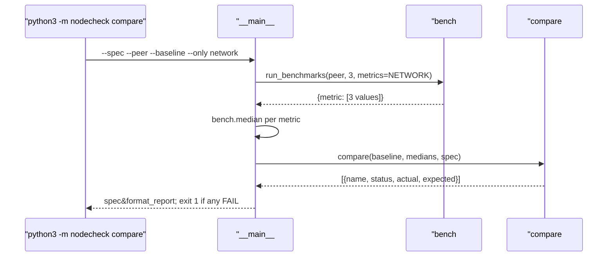

# 05 · Fault drill 1: throttle the NIC with tc, catch it against the baseline

[中文](05-compare-baseline.zh-CN.md)

> Step type: **fault drill**. Inject a fault, show the tool misses it (red), add the check (green), and prove it with output from before, during and after the fault.

## 1. The problem

Step 4 stored a baseline, but nothing compared new numbers with it. A NIC that only delivers 1 Gbit/s instead of 5 is still `up`, with no kernel errors, so `check` passes it. In a data centre that node would be handed over, and a multi-node job would run at the speed of its slowest link.

The fault: on node-1, `tc` replaces the NIC's outgoing queue with a token bucket that lets through 1 Gbit/s:

```
sudo tc qdisc add dev eth0 root tbf rate 1gbit burst 256kb latency 50ms   # inject
sudo tc qdisc del dev eth0 root                                           # restore
```

Reproduced by `tests/test_compare.py`. The fixture `tests/fixtures/node-1/fault-tbf/` is node-1's real iperf3 and ping output under that limit (0.953 Gbit/s), with `tc.txt` showing the qdisc before and after. While `compare.py` was a stub that passed everything (the tool "not catching it"), 9 cases failed on assertions; the 4 that expect *no* flag already passed.

Drill on node-1 (`compare --only network`, against the 18:12 baseline of 5.03 Gbit/s):

| | Bandwidth | Verdict | Exit |
|---|---|---|---|
| before | 5.73 Gbit/s (+14%) | PASS | 0 |
| **tbf 1 Gbit/s** | **0.95 Gbit/s (−81%)** | **FAIL** | **1** |
| after | 5.73 Gbit/s (+14%) | PASS | 0 |

## 2. What it is

**The path of a packet, and where tc works**



- A program can't touch the NIC; it writes into a **socket** (IP + port + a send and a receive buffer in the kernel). When the send buffer is full, `write()` waits: that's how iperf3 "feels" a slow network.
- **qdisc** (queueing discipline): the queue in front of each NIC's **outgoing** side, deciding the order and pace. Ubuntu's default here is `mq` with `fq_codel` per queue (`tc.txt` after the drill).
- **`tc`** (traffic control, iproute2, like `ip`) shows and replaces qdiscs. Shaping happens on **egress** only: to slow node-1's iperf3 (node-1 sends, node-2 receives), the limit goes on node-1.

**tbf (token bucket filter)**

| Option | Meaning |
|---|---|
| `rate 1gbit` | tokens are added at 1 Gbit/s; each packet needs tokens for its size |
| `burst 256kb` | the bucket holds at most 256 KB, so after a pause 256 KB can go at once. In tc, `kb` is kilo**bytes**, `kbit` kilo**bits** |
| `latency 50ms` | a packet that would wait longer than 50 ms is dropped, so the queue can't grow forever |

0.953 rather than 1.000 Gbit/s: tbf counts whole Ethernet frames, iperf3 counts only data; headers are about 5%.

**compare**

The spec (`benchmark.compare`) gives each metric a direction and thresholds:

```json
"net_gbit_per_s": {"better": "higher", "warn_drop": 0.15, "fail_drop": 0.25},
"net_latency_ms": {"better": "lower"}
```

| Status | When |
|---|---|
| FAIL | worse than the baseline by `fail_drop` or more (25%) |
| WARN | worse by `warn_drop` or more (15%), or no value this time |
| PASS | less worse than that, or **better** than the baseline |
| INFO | shown, not judged: no thresholds in the spec (latency, in this step) |

| Code | What it does |
|---|---|
| `compare#compare` | one result per metric that was run again; same shape as the spec checks |
| `compare#_compare_one` | change = now / baseline − 1; "worse" flips sign for `better: lower`; picks the status |
| `compare.NETWORK` | what `--only network` re-runs: iperf3 and ping, about 45 s instead of 4 minutes |
| `bench#run_benchmarks(metrics=...)` | the same commands as the baseline, only the chosen metrics |
| `__main__#main` (`compare`) | median of 3 runs → compare → report; exit 1 on any FAIL |
| `spec#format_report` | the name column now fits the longest name |

## 3. Code path



## 4. Why this way

| Choice | Why | Alternative and cost |
|---|---|---|
| 🤖 thresholds per metric, in the spec | different metrics vary differently; the spec already holds "what's acceptable" for the machine type | one number in the code: simple, wrong for at least one metric |
| 🤖 WARN 15%, FAIL 25% | bandwidth varied 7% within one baseline and **14% between two sessions** (5.03 → 5.73); a fault of −81% is far past both | 5% or 10%: false alarms every evening |
| 🤖 better than baseline is never flagged | +14% is luck (or a better host), not a fault | flag big changes both ways: catches a stale baseline, but noisy |
| 🤖 latency shown, not judged (INFO) | 0.46 ms swings by tens of percent; judging it needs its own design (next step) | judge it at 25% too: false alarms |
| 🤖 `--only network` | 45 s per check instead of 4 minutes | always everything: slower drills, more CPU credits used |
| 🤖 no value → WARN | after a VM restart the iperf3 server is gone; not seen isn't fine | skip it: a missing check looks like a pass |
| 🤖 red = stub that passes everything | it is literally "a tool that doesn't catch it"; tests fail on assertions, not import errors | no stub: red for the wrong reason |
| 🤖 fixture captured under the real fault | the numbers and format are real; the test runs anywhere | made-up numbers: easy, but could hide format surprises |
| 🤖 `burst 256kb` | at 1 Gbit/s the bucket must hold at least what flows between two timer ticks; the 4 KB (`32kbit`) in the first plan risked a rate well below the target. Measured with 256 KB: 0.95 Gbit/s | bigger burst: short spikes above 1 Gbit/s |

## 5. Interview topics here

**Conclusion**: the code is a small comparison; the substance is **where the thresholds come from** (measured noise) and **proving the check works** by breaking the machine on purpose.

| Topic | Code | Judgement here |
|---|---|---|
| 📗 XL-N2.3 how Linux sends packets | the qdisc step | tc sits between the IP stack and the driver, on the way **out** |
| 📗 XL-N4.22 TCP isn't lossless end to end | `latency 50ms` | tbf drops what waits too long; TCP retransmits, and throughput falls to the rate |
| 📗 DE-N64 network congestion | the tbf queue | a full queue means waiting, then drops: congestion on demand |
| 📗 TS-SS50 limiting resources | `tc qdisc add ... tbf` | the same idea as capping CPU: make the limit artificial and controllable |
| 📗 TS-SS7 baseline first | `compare#compare` | "how much worse" needs "what normal was". **When not to compare**: a node with no baseline yet: use the spec checks instead |
| ➕ thresholds come from noise | `benchmark.compare` | measure the spread first, then set the line beyond it |
| ➕ egress only | the drill runs on node-1 | shaping node-2 wouldn't change node-1's upload |
| ➕ frames vs payload | 0.953, not 1.000 | header overhead about 5% |

Scenario anchors:
- "Before I trusted the comparison, I broke the machine on purpose: tc limited node-1 to 1 Gbit/s, the tool reported minus 81% and failed with exit code 1, and after removing the limit it passed again."
- "I set the thresholds from the noise I'd measured: bandwidth moved 14% between two sessions, so a warning starts at 15% and a failure at 25%."

## 6. Follow-up chain

1. **How would you check a node's network performance against what it should be?** Measure with fixed commands, compare with this node's baseline, and judge each metric with thresholds wider than its normal noise.
2. **How did you test that check?** Fault injection: tc's token bucket limited the NIC to 1 Gbit/s; the tool failed it, and passed again after removal.
3. **What does tc actually change?** The qdisc, the queue in front of the NIC on the way out. Default here is fq_codel; tbf releases packets only as fast as tokens arrive.
4. **Why did you apply it on node-1, not node-2?** Shaping is egress only, and node-1 is the one sending in the iperf3 test.
5. **How did you choose 15% and 25%?** From measured variation: 7% within a baseline, 14% between sessions. Better than baseline is never flagged.

## 7. How to say it

- "tc lets you replace the queue in front of a network card. I used a token bucket to cap node-1 at 1 gigabit."
- "The comparison flagged minus 81% and exited with 1, so a script checking many nodes can pick that one out."
- "I don't trust a check until I've seen it fail."

## 8. Sources

- tc(8), traffic control and qdiscs; "Shaping occurs on egress" — https://man7.org/linux/man-pages/man8/tc.8.html
- tc-tbf(8), token bucket filter: rate, burst, latency — https://man7.org/linux/man-pages/man8/tc-tbf.8.html
- Xiaolin (Chinese), 2.3 how Linux sends and receives packets — https://xiaolincoding.com/network/1_base/how_os_deal_network_package.html

## 9. Self-check

<details>
<summary>1. Bandwidth is 5.73 Gbit/s against a baseline of 5.03. PASS, WARN or FAIL?</summary>

PASS. Better than the baseline is never flagged.
</details>

<details>
<summary>2. You put the tbf limit on node-2, then run the test from node-1 (node-1 sends). What happens?</summary>

Almost nothing: tc shapes outgoing traffic, and node-2 only sends small ACKs. node-1's upload isn't limited.
</details>

<details>
<summary>3. (Only if you really get it) Why is a stub that always returns PASS a fair "red" for a fault drill, and what would make it an unfair one?</summary>

It behaves exactly like a missing check: the fault goes unreported, so tests fail on assertions about the verdict. It would be unfair if the tests failed for another reason (import error, wrong function name), because then red wouldn't show that the behaviour is missing.
</details>

## 10. Replay time

30 minutes.
