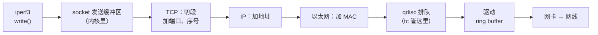
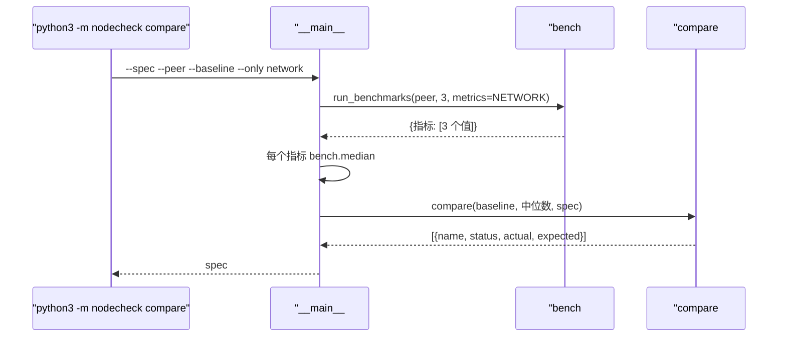

# 05 · 故障演练 1：用 tc 给网卡限速，和 baseline 对比抓出来

[English](05-compare-baseline.md)

> 步骤类型：**故障演练**。注入故障 → 证明工具没抓到（红）→ 加检查（绿）→ 用故障前、中、后三次输出证明。

## 1. 问题

第 4 步存了 baseline，但没有东西拿新测的数和它比。一块网卡只跑到 1 Gbit/s（正常是 5），它照样是 `up`、内核日志没报错，`check` 会放行。在机房里，这台机器会被交给客户；多台机器一起跑的任务，会被这条最慢的链路拖住。

故障：在 node-1 上用 `tc` 把网卡出口的队伍换成一个令牌桶，每秒只放行 1 Gbit：

```
sudo tc qdisc add dev eth0 root tbf rate 1gbit burst 256kb latency 50ms   # 注入
sudo tc qdisc del dev eth0 root                                           # 恢复
```

复现测试：`tests/test_compare.py`。fixture `tests/fixtures/node-1/fault-tbf/` 是限速时 node-1 上 iperf3 和 ping 的真实输出（0.953 Gbit/s），`tc.txt` 记了限速前后的 qdisc。`compare.py` 还是"一律 PASS"的桩时（＝工具没抓到），9 个用例因断言失败而红；4 个期望"不报"的本来就过。

node-1 上的演练（`compare --only network`，baseline 是 18:12 测的 5.03 Gbit/s）：

| | 带宽 | 判 | 退出码 |
|---|---|---|---|
| 限速前 | 5.73 Gbit/s（+14%） | PASS | 0 |
| **tbf 1 Gbit/s** | **0.95 Gbit/s（−81%）** | **FAIL** | **1** |
| 恢复后 | 5.73 Gbit/s（+14%） | PASS | 0 |

## 2. 是什么

**一个包要走的路，tc 在哪一段**



- 程序碰不到网卡，只能往 **socket**（IP + 端口 + 内核里的发送、接收缓冲区）里写。发送缓冲区满了，`write()` 就等：iperf3 就是这样"感觉到"网络慢的。
- **qdisc**（排队规则）：每块网卡**出口**前的队伍，决定包的顺序和速度。这台 Ubuntu 默认是 `mq`，每条队列下面一个 `fq_codel`（演练后的 `tc.txt` 里就是它）。
- **`tc`**（traffic control，和 `ip` 同属 iproute2）用来查看、替换 qdisc。限速只发生在**出方向**：要让 node-1 的 iperf3 变慢（node-1 发、node-2 收），就要限 node-1。

**tbf（令牌桶）**

| 参数 | 意思 |
|---|---|
| `rate 1gbit` | 按 1 Gbit/s 往桶里放令牌；每个包要拿走和自己一样大的令牌 |
| `burst 256kb` | 桶最多存 256 KB，空闲后可以一下子放行 256 KB。tc 里 `kb` 是千**字节**，`kbit` 才是千**比特** |
| `latency 50ms` | 要等超过 50 ms 的包直接丢掉，队伍不会无限长 |

是 0.953 不是 1.000：tbf 按整个以太网帧算，iperf3 只算数据，包头约占 5%。

**compare**

规格（`benchmark.compare`）给每个指标写方向和门槛：

```json
"net_gbit_per_s": {"better": "higher", "warn_drop": 0.15, "fail_drop": 0.25},
"net_latency_ms": {"better": "lower"}
```

| 状态 | 什么时候 |
|---|---|
| FAIL | 比 baseline 差 `fail_drop`（25%）或更多 |
| WARN | 差 `warn_drop`（15%）或更多；或者这次没测到值 |
| PASS | 差得没那么多，或者**比 baseline 好** |
| INFO | 只显示、不判：规格里没写门槛（这一步的延迟） |

| 代码 | 做什么 |
|---|---|
| `compare#compare` | 每个重跑过的指标一条结果，格式和规格检查一样 |
| `compare#_compare_one` | 变化 = 现在 / baseline − 1；`better: lower` 时"变差"的方向反过来；判状态 |
| `compare.NETWORK` | `--only network` 重跑的：iperf3 和 ping，约 45 秒（全套要 4 分钟） |
| `bench#run_benchmarks(metrics=...)` | 和 baseline 同样的命令，只跑选中的指标 |
| `__main__#main`（`compare`） | 3 次取中位数 → 比较 → 报告；有 FAIL 退出码 1 |
| `spec#format_report` | 名字那一列按最长的名字对齐 |

## 3. 代码路径



## 4. 为什么这样做

| 选择 | 为什么 | 替代方案和代价 |
|---|---|---|
| 🤖 门槛按指标分别定，写在规格里 | 不同指标的波动不一样；"什么算合格"本来就写在机型规格里 | 代码里写死一个数：简单，但总有一个指标不合适 |
| 🤖 WARN 15%、FAIL 25% | 带宽在同一次 baseline 里差 7%，**两次之间差 14%**（5.03 → 5.73）；故障是 −81%，远超两条线 | 5% 或 10%：每天晚上都误报 |
| 🤖 比 baseline 好不报 | +14% 是运气（或者换了台更好的宿主机），不是故障 | 两个方向都报：能发现 baseline 过时，但很吵 |
| 🤖 延迟只显示不判（INFO） | 0.46 ms 动不动差几十个百分点；要判得单独设计（下一步） | 也按 25% 判：误报 |
| 🤖 `--only network` | 每次检查 45 秒，不是 4 分钟 | 每次全跑：演练慢，还多花 CPU 积分 |
| 🤖 没测到值 → WARN | VM 重启后 iperf3 服务端没了；没看到不等于没问题 | 跳过：漏掉的检查看起来像通过 |
| 🤖 红灯 = 一律 PASS 的桩 | 它就是"一个没抓到故障的工具"；测试因断言失败而红，不是 import 报错 | 不写桩：红的原因不对 |
| 🤖 fixture 在真故障下抓 | 数字和格式都是真的；测试在哪都能跑 | 编数字：省事，但可能藏着格式上的意外 |
| 🤖 `burst 256kb` | 1 Gbit/s 时，桶至少要装下两次时钟中断之间流过的数据；最初计划的 4 KB（`32kbit`）可能让速率远低于目标。256 KB 实测 0.95 Gbit/s | 更大：会有超过 1 Gbit/s 的短暂尖峰 |

## 5. 八股在这里

**结论**：代码只是一个比较；真正的内容是**门槛从哪来**（测出来的波动），以及**故意把机器弄坏来证明检查有效**。

| 八股 | 代码在哪 | 这里的判断 |
|---|---|---|
| 📗 XL-N2.3 Linux 怎么发包 | qdisc 那一段 | tc 在 IP 协议栈和驱动之间，**出去**的路上 |
| 📗 XL-N4.22 TCP 一定不丢数据吗 | `latency 50ms` | tbf 会丢等太久的包；TCP 重传，吞吐降到限速值 |
| 📗 DE-N64 网络拥塞 | tbf 的队伍 | 队伍满了先等、再丢：人为制造的拥塞 |
| 📗 TS-SS50 限制资源 | `tc qdisc add ... tbf` | 和限制 CPU 一个思路：把限制做成人为、可控的 |
| 📗 TS-SS7 先测基线 | `compare#compare` | "差了多少"要先知道"正常是多少"。**什么时候不用比 baseline**：新机器还没有 baseline，就用规格检查 |
| ➕ 门槛从波动来 | `benchmark.compare` | 先测出正常范围，再把线画在范围外 |
| ➕ 只管出方向 | 演练在 node-1 上 | 限 node-2 不会让 node-1 的上传变慢 |
| ➕ 帧和数据 | 0.953 不是 1.000 | 包头约 5% |

场景锚点：
- "Before I trusted the comparison, I broke the machine on purpose: tc limited node-1 to 1 Gbit/s, the tool reported minus 81% and failed with exit code 1, and after removing the limit it passed again."
- "I set the thresholds from the noise I'd measured: bandwidth moved 14% between two sessions, so a warning starts at 15% and a failure at 25%."

## 6. 面试追问链

1. **怎么检查一台机器的网络性能达没达标？** 用固定命令测，和这台机器的 baseline 比，每个指标的门槛要比它正常的波动宽。
2. **这个检查你怎么证明它有效？** 故障注入：tc 的令牌桶把网卡限到 1 Gbit/s，工具报 FAIL；拆掉后又 PASS。
3. **tc 到底改了什么？** qdisc，网卡出口前的队伍。这里默认是 fq_codel；tbf 只按令牌到达的速度放行。
4. **为什么限 node-1 不限 node-2？** 限速只管出方向，iperf3 测试里发数据的是 node-1。
5. **15% 和 25% 怎么定的？** 按测到的波动：同一次 baseline 里 7%，两次之间 14%。比 baseline 好不报。

## 7. 英文说法

- "tc lets you replace the queue in front of a network card. I used a token bucket to cap node-1 at 1 gigabit."
- "The comparison flagged minus 81% and exited with 1, so a script checking many nodes can pick that one out."
- "I don't trust a check until I've seen it fail."

## 8. 资料

- tc(8)：traffic control 和 qdisc；"Shaping occurs on egress" — https://man7.org/linux/man-pages/man8/tc.8.html
- tc-tbf(8)：令牌桶，rate、burst、latency — https://man7.org/linux/man-pages/man8/tc-tbf.8.html
- 小林 2.3：Linux 系统是如何收发网络包的？ — https://xiaolincoding.com/network/1_base/how_os_deal_network_package.html

## 9. 自测题

<details>
<summary>1. 带宽 5.73 Gbit/s，baseline 5.03。PASS、WARN 还是 FAIL？</summary>

PASS。比 baseline 好不报。
</details>

<details>
<summary>2. 把 tbf 限速加在 node-2 上，再从 node-1 发起测试（node-1 发数据）。会怎样？</summary>

几乎没变化：tc 只管发出去的流量，node-2 只往回发很小的 ACK。node-1 的上传没被限。
</details>

<details>
<summary>3. （真懂才答得出）为什么"一律返回 PASS 的桩"是故障演练里公平的红灯？什么情况下就不公平了？</summary>

它的表现和"没有这个检查"一模一样：故障没被报出来，测试因为对判决的断言失败而红。如果测试是因为别的原因失败（import 报错、函数名不对），就不公平了：那样的红不能说明"缺的是这个行为"。
</details>

## 10. 预计回放时间

30 分钟。
