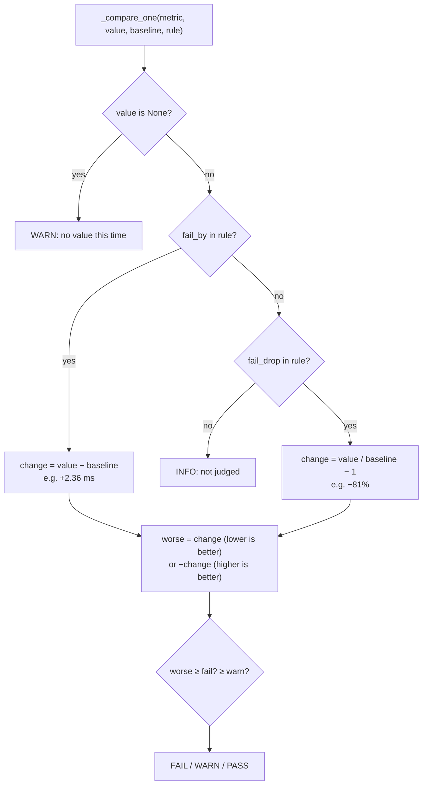

# 06 · Fault drill 2: bandwidth is not latency

[中文](06-bandwidth-is-not-latency.zh-CN.md)

> Step type: **fault drill**. This time the red needed no stub: the tool from the previous step already missed the fault.

## 1. The problem

The comparison from step 5 judges bandwidth, CPU and disk, and only shows latency. Add 2 ms to every packet node-1 sends, and bandwidth hardly moves, so the tool says everything is fine:

```
sudo tc qdisc add dev eth0 root netem delay 2ms limit 10000   # inject
sudo tc qdisc del dev eth0 root                               # restore
```

```
net_gbit_per_s 5.65 Gbit/s (+12%)   expected 5.03 Gbit/s, WARN -15%, FAIL -25%   PASS
net_latency_ms 2.82 ms (+509%)      expected 0.46 ms, not judged                 INFO
Result: 0 FAIL, 0 WARN                                                (exit code 0)
```

Every round trip took 2.4 ms longer, about six times the baseline, and the tool passed it. Inside a data centre a round trip is usually well under a millisecond, so this matters: a job that exchanges results between nodes at every step slows down while every bandwidth test passes.

Reproduced by `tests/test_compare.py` with `tests/fixtures/node-1/fault-delay/` (real iperf3 and ping output under the delay, plus `tc.txt`). With the step 5 code unchanged, 6 new cases failed on assertions; `test_added_delay_leaves_bandwidth_alone` passed, which is the reason for the miss.

Drill on node-1 after the fix:

| | Bandwidth | Latency | Exit |
|---|---|---|---|
| before | 5.73 (+14%) PASS | 0.76 ms (+0.30 ms) PASS | 0 |
| **netem 2 ms** | **5.71 (+13%) PASS** | **2.79 ms (+2.33 ms) FAIL** | **1** |
| after | 5.74 (+14%) PASS | 0.70 ms (+0.24 ms) PASS | 0 |

## 2. What it is

**Three words**

| Word | Meaning | Measured with |
|---|---|---|
| bandwidth | how much data per second the link can carry (lanes on a road) | `iperf3`, Gbit/s |
| latency / round-trip time (RTT) | how long one packet takes to get there and back (time for one trip) | `ping`, ms |
| throughput | how much a given transfer actually achieved | what iperf3 reports for one TCP stream |

**netem**: another qdisc (like tbf), which holds every outgoing packet for a while before it leaves. `delay 2ms` adds 2 ms one way; ping's RTT goes up by about that. `limit 10000` raises the queue size: at 5.7 Gbit/s, 5 ms of delay keeps roughly 2,000 packets waiting, more than the default limit of 1,000, so packets would be dropped and we'd be testing loss, not delay.

**Why more delay also cut bandwidth** (trial before choosing 2 ms):

| Added delay | Bandwidth | Ping average |
|---|---|---|
| none | 5.73 Gbit/s | 1.03 ms |
| **2 ms** | **5.65** | **2.94 ms** |
| 5 ms | 3.78 (−25%) | 6.10 ms |
| 10 ms | 2.20 (−56%) | 10.67 ms |

TCP may only have so much data sent but not yet acknowledged: the **window**. When it's full, the sender waits for ACKs. So one stream's throughput ≈ window ÷ RTT. From the numbers: 3.78 Gbit/s × 5.5 ms ≈ 2.6 MB and 2.20 × 10.5 ms ≈ 2.9 MB, so on this VM one stream's window tops out around 2.7 MB. Filling 5.7 Gbit/s needs about 1.8 MB at 2 ms (fits) and 3.9 MB at 5 ms (doesn't). The ceiling comes from the socket buffer limits `net.ipv4.tcp_wmem` / `tcp_rmem` (their max defaults to at most 4 MB, and part of a buffer is counted as overhead); we didn't read the VM's actual settings.

So only 2 ms gives the fault we want: latency up, bandwidth unchanged.

**Two kinds of threshold**

```json
"net_gbit_per_s": {"better": "higher", "warn_drop": 0.15, "fail_drop": 0.25},
"net_latency_ms": {"better": "lower", "warn_by": 1.0, "fail_by": 1.5}
```

| Kind | Fields | Meaning | Used for |
|---|---|---|---|
| share of the baseline | `warn_drop`, `fail_drop` | 15% / 25% worse | bandwidth, CPU, disk |
| the metric's own unit | `warn_by`, `fail_by` | 1 / 1.5 ms more | latency |

The report follows the threshold: latency shows `+2.36 ms`, not `+509%`.

| Code | What changed |
|---|---|
| `compare#_compare_one` | `fail_by` in the rule → change = now − baseline, in the metric's unit; otherwise now / baseline − 1 |
| `config/b2ats_v2.json` | latency gets `warn_by: 1.0`, `fail_by: 1.5`; the note says why |

## 3. Code path



## 4. Why this way

| Choice | Why | Alternative and cost |
|---|---|---|
| 🤖 2 ms, not the planned 5 ms | at 5 ms bandwidth fell 25%, so the bandwidth check would catch it on its own and the drill wouldn't show the gap | 5 ms: a louder fault, but not "missed by bandwidth" |
| 🤖 latency judged in ms, not % | a percentage of 0.46 ms is mostly noise: with no fault it was +0.30 to +0.64 ms (up to +139%) on the same evening | 25% like bandwidth: fails almost every run |
| 🤖 WARN +1 ms, FAIL +1.5 ms | above all the noise seen (+0.64 ms), below the fault (+2.33 ms) | tighter: catches smaller faults, more false alarms; looser: misses 2 ms |
| 🤖 keep ping's average | one 6 ms spike in 20 packets moves the average by ~0.3 ms, far from 1.5; and compare already takes the median of 3 runs; changing it would mean a new baseline | per-packet median: steadier, but a new parser and a new baseline. Risk kept: many spikes could give a WARN |
| 🤖 `limit 10000` | the default queue (1,000 packets) dropped packets at 5 ms: 3.46 vs 3.78 Gbit/s | default: delay and loss mixed together |
| 🤖 red without a stub | the existing tool genuinely passed the fault; that **is** the story | a stub: would hide that the real code missed it |
| 🤖 report latency as `+2.36 ms` | says what happened in terms a person can act on | `+509%`: alarming and meaningless |

## 5. Interview topics here

**Conclusion**: one metric is not enough. Each threshold must use the units in which that metric's noise is small compared with the faults you care about.

| Topic | Code | Judgement here |
|---|---|---|
| 📗 DE-N57/58/59 latency, bandwidth, throughput | the two network metrics | different questions; measured separately, judged separately |
| 📗 DE-N60 latency or throughput more important? | `net_latency_ms` thresholds | depends on the work: many small exchanges (AI training sync, queries) care about latency. **When bandwidth alone is enough**: bulk copies and backups |
| 📗 DE-N22 round-trip time | `parse_ping` | ping's avg is RTT; netem on one side adds its delay once |
| 📗 XL-N4.2 window, flow and congestion control | the 5 ms and 10 ms rows | throughput ≈ window ÷ RTT; measured ceiling ~2.7 MB |
| 📗 XL-N5.2 how ping works | `ping -c 20 -i 0.2` | small ICMP echo packets; they don't fill a queue, so they show delay, not bandwidth |
| 📗 XL-S10.1 network metrics | both metrics in the baseline | bandwidth, latency, and why you need both |
| 📗 TS-RS25 / XL-N4.5 kernel parameters (`tcp_rmem`) | not changed | raising the buffer max would let one stream fill more bandwidth at higher RTT. **Not done here**: we want default behaviour, and 2 ms already fits |
| 📗 USE method | the gap this step found | USE looks at utilisation, saturation and errors; latency needs its own check |
| ➕ percentages of small numbers | `warn_by` / `fail_by` | use absolute units when the baseline is tiny |
| ➕ netem queue limit | `limit 10000` | otherwise a delay test becomes a loss test |

Scenario anchors:
- "I added 2 ms of delay with netem. Bandwidth stayed at 5.7 Gbit/s, so a bandwidth-only check passed, but every round trip took 2.3 ms longer. So I added a latency check, in milliseconds above the baseline."
- "At 5 ms the bandwidth dropped as well: a single TCP stream can only have so much data unacknowledged, so throughput is roughly window divided by round-trip time."

## 6. Follow-up chain

1. **What's the difference between bandwidth and latency?** How much per second versus how long one trip takes. A link can have plenty of one and too much of the other.
2. **How did you find the gap?** A drill: netem added 2 ms; bandwidth unchanged; the comparison passed. That's a miss, so the tool needed a latency check.
3. **Why not a percentage threshold for latency, like bandwidth?** The baseline is 0.46 ms; normal variation was up to +139%. In milliseconds the noise was under 0.7 ms and the fault 2.3 ms.
4. **Why did 5 ms of delay reduce bandwidth?** One TCP stream is limited by its window: throughput ≈ window ÷ RTT. Here the window topped out around 2.7 MB, enough for 2 ms but not 5.
5. **How would you get full bandwidth at higher latency?** Raise the socket buffer limits (`tcp_rmem` / `tcp_wmem` max), or use several parallel streams (`iperf3 -P`).

## 7. How to say it

- "Bandwidth is how much per second; latency is how long one round trip takes. They fail independently."
- "My bandwidth check passed a node with 2 milliseconds of extra latency, so I added a latency check."
- "For latency I set the threshold in milliseconds, because a percentage of half a millisecond is mostly noise."

## 8. Sources

- tc-netem(8), "Delays the packets before sending"; the `limit` option — https://man7.org/linux/man-pages/man8/tc-netem.8.html
- tcp(7), `tcp_rmem` / `tcp_wmem` (min, default, max) and `tcp_adv_win_scale` — https://man7.org/linux/man-pages/man7/tcp.7.html
- Xiaolin (Chinese), 4.2 TCP retransmission, sliding window, flow and congestion control — https://xiaolincoding.com/network/3_tcp/tcp_feature.html
- Brendan Gregg, The USE Method — https://www.brendangregg.com/usemethod.html

## 9. Self-check

<details>
<summary>1. With 2 ms of added delay, bandwidth was 5.71 Gbit/s and latency 2.79 ms. What did the tool report before and after this step?</summary>

Before: bandwidth PASS, latency INFO, exit 0 (missed). After: bandwidth PASS, latency FAIL (+2.33 ms), exit 1.
</details>

<details>
<summary>2. Why is latency's threshold "+1.5 ms" and not "+25%"?</summary>

The baseline is 0.46 ms. With no fault, latency was up to 0.64 ms higher (+139%), so 25% would fail almost every run. In milliseconds, normal noise stayed under 0.7 ms and the fault added 2.3 ms.
</details>

<details>
<summary>3. (Only if you really get it) At 10 ms one stream got 2.20 Gbit/s. Estimate its window, and say what you'd change to get ~5.7 Gbit/s back at 10 ms.</summary>

Window ≈ 2.20 Gbit/s ÷ 8 × 10.5 ms ≈ 2.9 MB. To fill 5.7 Gbit/s at 10.5 ms you need ≈ 7.5 MB in flight: raise the socket buffer max (`tcp_wmem` on the sender, `tcp_rmem` on the receiver), or use several streams in parallel so each needs a smaller window.
</details>

## 10. Replay time

30 minutes. **This is the main interview story: practise saying section 7 aloud.**
