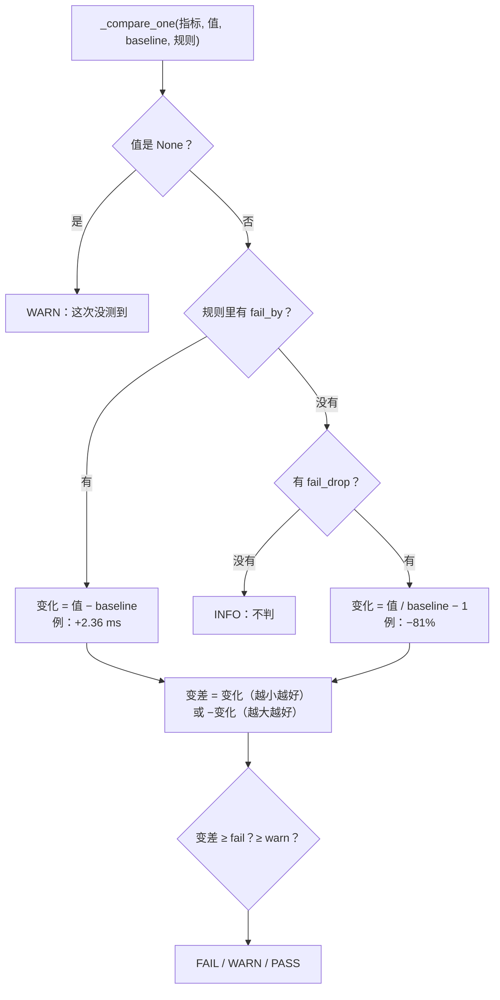

# 06 · 故障演练 2：带宽不等于延迟

[English](06-bandwidth-is-not-latency.md)

> 步骤类型：**故障演练**。这次红灯不用写桩：上一步的工具本来就漏掉了这个故障。

## 1. 问题

第 5 步的 compare 判带宽、CPU、盘，延迟只显示不判。给 node-1 发出去的每个包加 2 ms，带宽几乎不动，工具就说一切正常：

```
sudo tc qdisc add dev eth0 root netem delay 2ms limit 10000   # 注入
sudo tc qdisc del dev eth0 root                               # 恢复
```

```
net_gbit_per_s 5.65 Gbit/s (+12%)   expected 5.03 Gbit/s, WARN -15%, FAIL -25%   PASS
net_latency_ms 2.82 ms (+509%)      expected 0.46 ms, not judged                 INFO
Result: 0 FAIL, 0 WARN                                                （退出码 0）
```

每个来回多了 2.4 ms，约是 baseline 的 6 倍，工具照样放行。机房内一个来回通常远不到 1 ms，所以这很要紧：每算一步都要在机器之间交换结果的任务会变慢，而带宽测试全部通过。

复现测试：`tests/test_compare.py`，fixture `tests/fixtures/node-1/fault-delay/`（加延迟时 iperf3、ping 的真实输出，加 `tc.txt`）。第 5 步的代码一行没改，6 个新用例因断言失败而红；`test_added_delay_leaves_bandwidth_alone` 本来就过，它就是漏报的原因。

修好后在 node-1 上的演练：

| | 带宽 | 延迟 | 退出码 |
|---|---|---|---|
| 加之前 | 5.73（+14%）PASS | 0.76 ms（+0.30 ms）PASS | 0 |
| **netem 2 ms** | **5.71（+13%）PASS** | **2.79 ms（+2.33 ms）FAIL** | **1** |
| 拆掉后 | 5.74（+14%）PASS | 0.70 ms（+0.24 ms）PASS | 0 |

## 2. 是什么

**三个词**

| 词 | 意思 | 用什么测 |
|---|---|---|
| 带宽（bandwidth） | 一条链路一秒能运多少数据（马路有几条车道） | `iperf3`，Gbit/s |
| 延迟 / 往返时间（latency / RTT） | 一个包到对面再回来要多久（跑一趟要多久） | `ping`，ms |
| 吞吐（throughput） | 某一次传输实际跑出来多少 | iperf3 一条 TCP 连接报的数 |

**netem**：和 tbf 一样是一种 qdisc，把每个发出去的包先扣住一会儿再放行。`delay 2ms` 单程加 2 ms，ping 的往返时间也就多了约 2 ms。`limit 10000` 把队伍调大：5.7 Gbit/s 加 5 ms 延迟时，大约有 2000 个包在排队，超过默认的 1000 个，就会丢包，测的就变成"丢包"而不是"延迟"了。

**为什么延迟再大一点，带宽也会掉**（选 2 ms 之前的试测）：

| 加的延迟 | 带宽 | ping 平均 |
|---|---|---|
| 不加 | 5.73 Gbit/s | 1.03 ms |
| **2 ms** | **5.65** | **2.94 ms** |
| 5 ms | 3.78（−25%） | 6.10 ms |
| 10 ms | 2.20（−56%） | 10.67 ms |

TCP 规定：发出去但还没被确认的数据，最多只能有那么多，这个量叫**窗口**。到了上限，发送方就停下来等 ACK。所以一条连接的吞吐 ≈ 窗口 ÷ 往返时间。用数字倒推：3.78 Gbit/s × 5.5 ms ≈ 2.6 MB，2.20 × 10.5 ms ≈ 2.9 MB，所以这台 VM 上一条连接的窗口大约到 2.7 MB 就到顶了。要跑满 5.7 Gbit/s，2 ms 时需要约 1.8 MB（够），5 ms 时需要约 3.9 MB（不够）。上限来自 socket 缓冲区的设置 `net.ipv4.tcp_wmem` / `tcp_rmem`（最大值默认不超过 4 MB，而且缓冲区有一部分要算作开销）；VM 上实际的值我们没去读。

所以只有 2 ms 是我们要的故障：延迟变大，带宽不变。

**两种门槛**

```json
"net_gbit_per_s": {"better": "higher", "warn_drop": 0.15, "fail_drop": 0.25},
"net_latency_ms": {"better": "lower", "warn_by": 1.0, "fail_by": 1.5}
```

| 种类 | 字段 | 意思 | 用在 |
|---|---|---|---|
| 占 baseline 的比例 | `warn_drop`、`fail_drop` | 差 15% / 25% | 带宽、CPU、盘 |
| 指标自己的单位 | `warn_by`、`fail_by` | 多 1 / 1.5 ms | 延迟 |

报告跟着门槛走：延迟写 `+2.36 ms`，不写 `+509%`。

| 代码 | 改了什么 |
|---|---|
| `compare#_compare_one` | 规格里有 `fail_by` → 变化 = 现在 − baseline，用指标自己的单位；否则 = 现在 / baseline − 1 |
| `config/b2ats_v2.json` | 延迟加 `warn_by: 1.0`、`fail_by: 1.5`；备注写了为什么 |

## 3. 代码路径



## 4. 为什么这样做

| 选择 | 为什么 | 替代方案和代价 |
|---|---|---|
| 🤖 加 2 ms，不是原计划的 5 ms | 5 ms 时带宽也掉了 25%，带宽检查自己就会抓到，演练就体现不出"漏报" | 5 ms：故障更明显，但不是"带宽漏掉的" |
| 🤖 延迟按 ms 判，不按百分比 | 0.46 ms 的百分比大多是噪音：同一个晚上不加故障就多了 0.30～0.64 ms（最多 +139%） | 和带宽一样用 25%：几乎每次都 FAIL |
| 🤖 WARN +1 ms、FAIL +1.5 ms | 高于见过的所有波动（+0.64 ms），低于故障（+2.33 ms） | 更紧：能抓更小的故障，误报更多；更松：会漏掉 2 ms |
| 🤖 ping 继续用平均值 | 20 个包里一次 6 ms 的尖峰只让平均多约 0.3 ms，离 1.5 很远；compare 还会取 3 次的中位数；改了要重测 baseline | 每个包取中位数：更稳，但要改解析、重测 baseline。保留的风险：尖峰多时可能 WARN |
| 🤖 `limit 10000` | 默认队伍（1000 个包）在 5 ms 时会丢包：3.46 vs 3.78 Gbit/s | 默认值：延迟和丢包混在一起 |
| 🤖 红灯不写桩 | 现有工具真的放行了这个故障，**这就是故事本身** | 写桩：会把"真代码漏报"这件事藏起来 |
| 🤖 报告里延迟写 `+2.36 ms` | 说清楚发生了什么，人能照着去查 | `+509%`：吓人但没意义 |

## 5. 八股在这里

**结论**：只看一个指标不够；每个门槛都要用"正常波动相对故障很小"的那种单位。

| 八股 | 代码在哪 | 这里的判断 |
|---|---|---|
| 📗 DE-N57/58/59 延迟、带宽、吞吐 | 两个网络指标 | 回答的是不同的问题；分开测、分开判 |
| 📗 DE-N60 延迟和吞吐哪个更重要 | `net_latency_ms` 的门槛 | 看业务：来回多、每次数据少的（AI 训练同步、查询）看延迟。**只看带宽就够的时候**：大批量拷贝、备份 |
| 📗 DE-N22 往返时间 | `parse_ping` | ping 的 avg 就是往返时间；netem 加在一边，延迟只加一次 |
| 📗 XL-N4.2 窗口、流量控制、拥塞控制 | 5 ms、10 ms 那两行 | 吞吐 ≈ 窗口 ÷ 往返时间；实测上限约 2.7 MB |
| 📗 XL-N5.2 ping 的原理 | `ping -c 20 -i 0.2` | ICMP 小包；填不满队伍，所以测出来的是延迟，不是带宽 |
| 📗 XL-S10.1 网络性能指标 | baseline 里两个都有 | 带宽、延迟，为什么两个都要 |
| 📗 TS-RS25 / XL-N4.5 内核参数（`tcp_rmem`） | 没改 | 调大缓冲区上限，一条连接在高延迟下能跑出更多带宽。**这里不改**：要测的是默认行为，2 ms 时也够用 |
| 📗 USE 方法 | 这一步找到的盲区 | USE 看使用率、饱和、错误；延迟要单独检查 |
| ➕ 小数字的百分比 | `warn_by` / `fail_by` | baseline 很小时用绝对单位 |
| ➕ netem 的队伍上限 | `limit 10000` | 不调大，延迟测试会变成丢包测试 |

场景锚点：
- "I added 2 ms of delay with netem. Bandwidth stayed at 5.7 Gbit/s, so a bandwidth-only check passed, but every round trip took 2.3 ms longer. So I added a latency check, in milliseconds above the baseline."
- "At 5 ms the bandwidth dropped as well: a single TCP stream can only have so much data unacknowledged, so throughput is roughly window divided by round-trip time."

## 6. 面试追问链

1. **带宽和延迟有什么区别？** 一秒能运多少 vs 跑一趟要多久。一条链路可能一个够、另一个不够。
2. **你怎么发现这个漏洞的？** 演练：netem 加 2 ms；带宽没变；compare 放行了。这就是漏报，所以工具要加延迟检查。
3. **延迟为什么不像带宽一样用百分比门槛？** baseline 是 0.46 ms，正常波动就有 +139%。按毫秒看，正常波动不到 0.7 ms，故障是 2.3 ms。
4. **为什么加 5 ms 延迟带宽会掉？** 一条 TCP 连接受窗口限制：吞吐 ≈ 窗口 ÷ 往返时间。这里窗口到 2.7 MB 左右就到顶，2 ms 够、5 ms 不够。
5. **高延迟下怎么跑满带宽？** 调大 socket 缓冲区上限（`tcp_rmem` / `tcp_wmem` 的 max），或者开几条连接并行（`iperf3 -P`）。

## 7. 英文说法

- "Bandwidth is how much per second; latency is how long one round trip takes. They fail independently."
- "My bandwidth check passed a node with 2 milliseconds of extra latency, so I added a latency check."
- "For latency I set the threshold in milliseconds, because a percentage of half a millisecond is mostly noise."

## 8. 资料

- tc-netem(8)："Delays the packets before sending"；`limit` 参数 — https://man7.org/linux/man-pages/man8/tc-netem.8.html
- tcp(7)：`tcp_rmem` / `tcp_wmem`（min、default、max）和 `tcp_adv_win_scale` — https://man7.org/linux/man-pages/man7/tcp.7.html
- 小林 4.2：TCP 重传、滑动窗口、流量控制、拥塞控制 — https://xiaolincoding.com/network/3_tcp/tcp_feature.html
- Brendan Gregg：The USE Method — https://www.brendangregg.com/usemethod.html

## 9. 自测题

<details>
<summary>1. 加 2 ms 延迟时，带宽 5.71 Gbit/s、延迟 2.79 ms。这一步之前和之后，工具分别报什么？</summary>

之前：带宽 PASS、延迟 INFO、退出码 0（漏报）。之后：带宽 PASS、延迟 FAIL（+2.33 ms）、退出码 1。
</details>

<details>
<summary>2. 延迟的门槛为什么是"+1.5 ms"，不是"+25%"？</summary>

baseline 是 0.46 ms。不加故障时延迟最多高了 0.64 ms（+139%），按 25% 几乎每次都 FAIL。按毫秒看，正常波动不到 0.7 ms，故障加了 2.3 ms。
</details>

<details>
<summary>3. （真懂才答得出）加 10 ms 时一条连接跑出 2.20 Gbit/s。估算它的窗口；要在 10 ms 下跑回约 5.7 Gbit/s，你会改什么？</summary>

窗口 ≈ 2.20 Gbit/s ÷ 8 × 10.5 ms ≈ 2.9 MB。10.5 ms 下要跑满 5.7 Gbit/s，路上要有约 7.5 MB：调大 socket 缓冲区上限（发送方 `tcp_wmem`、接收方 `tcp_rmem`），或者开几条连接并行，每条需要的窗口就小了。
</details>

## 10. 预计回放时间

30 分钟。**这是面试主故事：把第 7 节大声练几遍。**
