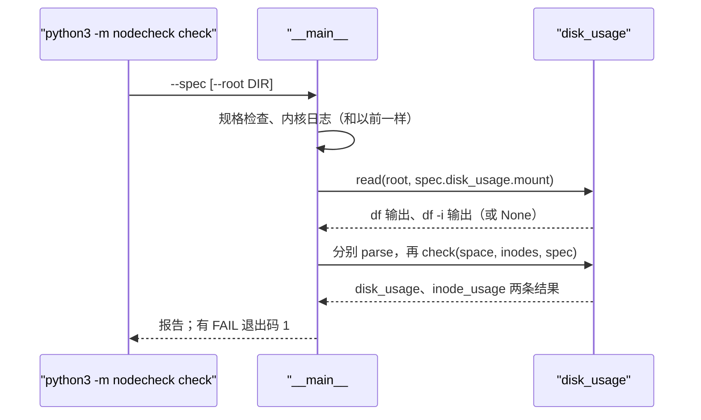

# 07 · 故障演练 3：盘够大，不等于还有空

[English](07-disk-full.md)

> 步骤类型：**故障演练**。把盘写满 → 证明体检没发现（红）→ 加用量检查（绿）→ 用写满前、中、后三次结果证明。

## 1. 问题

规格检查只问盘**够不够大**（至少 64 GiB），从不问**还剩多少**。一台盘用了 96% 的机器照样过关，第一个写检查点或日志的任务就会失败，而且常常连"为什么失败"都写不进日志。

故障，在 node-1 上用普通用户做：

```
fill=$(df -P -B1 / | awk 'NR==2{print int(($3+$4)*0.96-$3)}')   # 到 96% 还要多少字节
fallocate -l $fill /var/tmp/nodecheck-fill                       # 注入：瞬间完成，不写数据
rm -f /var/tmp/nodecheck-fill                                    # 恢复
```

复现测试：`tests/test_disk_usage.py`（11 个用例）。fixture 都是 node-1 的真实 `df` 输出：`tests/fixtures/node-1/commands/df.txt`、`df-i.txt`（正常），`tests/fixtures/node-1/fault-disk/df.txt`（`fallocate` 占了 60 GB 后）和 `df-after.txt`（删掉后）。`disk_usage.py` 还是"不看用量"的空壳时，9 个用例因断言失败而红。

node-1 上的演练（`check`，直接读真机器，不加 `--root`）：

| | `disk_usage` | `inode_usage` | 退出码 |
|---|---|---|---|
| 写满前 | 4%（58.5 GiB free）PASS | 1% PASS | 0 |
| **写到 96%** | **96%（2.4 GiB free）FAIL** | 1% PASS | **1** |
| 删掉后 | 4%（58.5 GiB free）PASS | 1% PASS | 0 |

## 2. 是什么

**怎么读 `df -P -B1 /`**

```
Filesystem        1-blocks        Used  Available Capacity Mounted on
/dev/root      65445814272 62811885568 2617151488      97% /
```

| 列 | 意思 |
|---|---|
| 1-blocks | 总大小，按 1 字节一块（`-B1`）：这里 61 GiB，盘是 64 GiB（分区和文件系统自己的记账占掉了其余） |
| Used / Available | 已用 / **普通用户**还能用多少 |
| Capacity | 已用 ÷（已用 + 可用），**往上取整**：96.0% 显示成 97% |

`-P`（POSIX 格式）保证每个文件系统一行，解析起来安全。

**两种"满"**

| 资源 | 是什么 | 怎么用光 |
|---|---|---|
| 空间 | 字节 | 一个巨大的文件、从不轮转的日志、检查点 |
| inode | 每个文件或目录一个，记着它的元信息（大小、属主、数据在哪）；数量在格式化时就定了 | 几百万个小文件（缓存、邮件队列）：`df` 显示空间还多，却建不了新文件 |

这块盘有 8,257,536 个 inode，用了 91,417 个。那个 60 GB 的文件只用了 1 个。

**预留块**：ext4 通常给 root 留 5%，这样普通用户把盘写满了，root 还能登录进去清理。这里 总量 − 已用 − 可用 = **16 MiB**：这个镜像几乎没留，普通用户能把盘写到 100%。所以演练只写到 96%，马上删掉。

**`fallocate` vs `dd`**：`fallocate` 让文件系统把这些块划给文件，但不真写：瞬间完成，也不花盘的突发额度。`dd` 会真的写 60 GB。

| 代码 | 做什么 |
|---|---|
| `disk_usage#read` | 跑 `df -P -B1 <挂载点>` 和 `df -P -i <挂载点>`；有 `--root` 时读 `commands/df.txt`、`df-i.txt` |
| `disk_usage#parse` | 从第一行文件系统数据里取总量、已用、可用，算出精确的已用比例；解析不了 → `None` |
| `disk_usage#check` | `disk_usage` 和 `inode_usage`：≥ 90% FAIL，≥ 80% WARN，读不到 WARN |
| `__main__#main`（`check`） | 在内核日志后面加这两项；挂载点从规格里来 |

## 3. 代码路径



## 4. 为什么这样做

| 选择 | 为什么 | 替代方案和代价 |
|---|---|---|
| 🤖 解析 `df` 的输出 | 和工程师自己看到的数一样；真实输出能当 fixture，`--root` 在哪都能测 | `os.statvfs`：不用调命令，但没有真实的东西可以抄成 fixture |
| 🤖 WARN 80%、FAIL 90% | 常见的报警线；离 100% 还留出处理的时间 | 只有一条线：要么太晚，要么太吵 |
| 🤖 用精确比例，不用 df 取整后的 | 96.0% 就是 96%；往上取整会把 89.1% 变成 FAIL | 直接用 df 那一列：简单，偶尔严一档 |
| 🤖 inode 也查，门槛相同 | inode 用光时，程序看到的和盘满一样，`df` 却显示有空间 | 只查空间：漏掉经典的小文件问题 |
| 🤖 inode 用光只用改过的 fixture 测 | 在 VM 上建 826 万个文件太慢 | 真演练：慢，多学不到什么 |
| 🤖 `fallocate`，只到 96% | 瞬间完成；这里几乎没有 root 预留，写到 100% 可能连登录、写日志都出问题 | `dd`：真写，慢，耗突发额度 |
| 🤖 读不到 `df` → WARN | 没看到不等于没问题 | PASS：漏掉的检查看起来像健康的盘 |

## 5. 八股在这里

**结论**："够大"和"有空"是两个检查；能用光的东西有两种。

| 八股 | 代码在哪 | 这里的判断 |
|---|---|---|
| 📗 TS-RS29 inode 是什么 | `inode_usage` | 每个文件一个；格式化时定数量；这里 826 万 |
| 📗 TS-SS17 inode 里存了什么 | — | 元信息：大小、属主、权限、时间、数据块位置；**不存文件名**（文件名在目录里） |
| 📗 TS-SS45 `df` 和 `du` 对不上 | 代码里没有 | 文件删了但还被进程开着：`du` 看不到，`df` 还算着，直到进程关掉它。处理：`lsof +L1` 找出来，重启进程或清空文件。**这里不适用**：演练删的文件没人开着，空间马上回来 |
| 📗 TS-JS29 找大文件 | FAIL 之后的排查 | `du -xh / \| sort -h \| tail`，或 `find / -xdev -size +1G` |
| 📗 TS-SS14 删 100 GB 文件 | — | 小文件很多时用 `find -delete` 或从空目录 `rsync --delete`，不用 `rm *`（参数太长） |
| ➕ df 往上取整 | `parse` | 96.0% 显示成 97% |
| ➕ 预留块 | 规格备注 | 通常给 root 留 5%；这个镜像只有 16 MiB |

场景锚点：
- "The health check only verified the disk was big enough. I filled it to 96% with fallocate, added a usage check for space and inodes, and the drill failed with exit code 1, then passed after cleanup."
- "I noticed this image reserves only 16 MB for root instead of the usual 5%, so a user process can fill the disk completely."

## 6. 面试追问链

1. **服务器盘满了，你查什么？** `df -h` 看空间，`df -i` 看 inode，再用 `du` 找大的；`df` 和 `du` 对不上，就找"删了还开着"的文件（`lsof +L1`）。
2. **inode 是什么？** 记一个文件元信息的地方；数量在格式化时定死。
3. **空间还有，怎么会"满"？** inode 用光了：几百万个小文件。
4. **为什么普通用户写不进去了，root 还能写？** 预留块（`tune2fs -m`），通常 5%。不过这个镜像只有 16 MiB。
5. **怎么不真写 60 GB 就测？** `fallocate` 只划走块，不写数据。

## 7. 英文说法

- "Big enough and has room are two different checks."
- "A disk can be full in two ways: out of space or out of inodes."
- "I filled the disk with fallocate, the check failed with exit code one, and passed again after I deleted the file."

## 8. 资料

- df(1)：`-P`、`-i`、`-B` — https://man7.org/linux/man-pages/man1/df.1.html
- fallocate(1)：给文件预分配空间 — https://man7.org/linux/man-pages/man1/fallocate.1.html
- tune2fs(8)：`-m` 预留块比例（"Normally, the default ... is 5%"） — https://man7.org/linux/man-pages/man8/tune2fs.8.html
- inode(7)：inode 里存什么 — https://man7.org/linux/man-pages/man7/inode.7.html
- 小林 7.1：文件系统全家桶（索引节点、目录项） — https://xiaolincoding.com/os/6_file_system/file_system.html

## 9. 自测题

<details>
<summary>1. df 显示 97%，我们的检查说 96%。谁对？</summary>

都对：精确值是 96.00%，df 打印时往上取整。
</details>

<details>
<summary>2. 一个 60 GB 的文件把盘写满了，inode 为什么还是 1%？</summary>

一个文件只用一个 inode，不管多大。
</details>

<details>
<summary>3. （真懂才答得出）df 说盘用了 95%，du 把 / 加起来只有 10%。怎么回事？不重启怎么把空间放出来？</summary>

通常是一个大文件被删了，但还有进程开着它（比如正在写的日志）：名字没了，`du` 数不到，但数据块要等最后一个进程关掉才释放。用 `lsof +L1` 找出来；重启那个进程，或者通过 `/proc/<pid>/fd/<n>` 把文件清空。
</details>

## 10. 预计回放时间

15 分钟。
