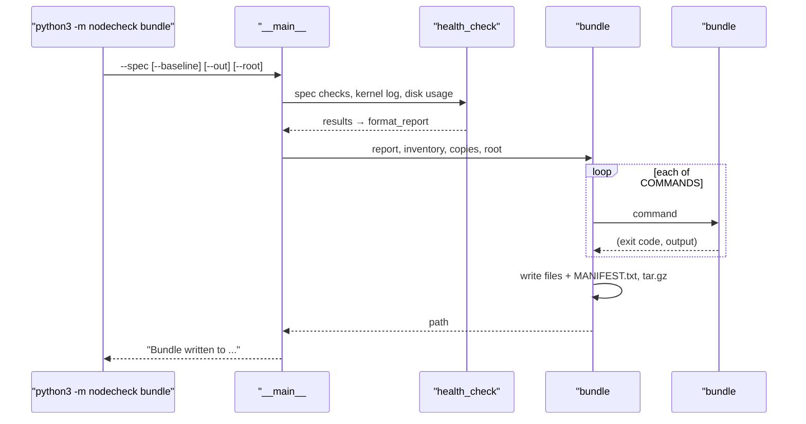

# 08 · One command to keep the evidence: the log bundle

[中文](08-log-bundle.zh-CN.md)

> Step type: **missing behaviour** (red → green) for the bundle; **checklist** for the incident write-up and the README.

## 1. The problem

The tool can now say FAIL. What happens next is someone logging in and typing a dozen commands to find out why: slowly, missing some, and maybe after a reboot has reset the kernel's ring buffer, the NIC counters and any tc rules. The evidence should be collected **at once, the same way every time**, into one file that can be handed to whoever investigates.

Reproduced by `tests/test_bundle.py` (9 cases). A fake runner answers the commands, so no VM is needed; the check report and inventory come from node-1's fixture (`--root`). While `make()` was a stub, all 9 failed on assertions (an early version failed with `FileNotFoundError` because no archive existed; the test helper now treats a missing archive as empty, so the failure is about content).

Real run on node-1, with a netem rule deliberately left on eth0:

```
$ python3 -m nodecheck bundle --spec config/b2ats_v2.json --baseline baselines/node-1.json --out /tmp/nodecheck-node-1-drill.tar.gz
Bundle written to /tmp/nodecheck-node-1-drill.tar.gz
$ tar xzf nodecheck-node-1-drill.tar.gz -O nodecheck-node-1-drill/tc-qdisc.txt
qdisc noqueue 0: dev lo root refcnt 2
qdisc netem 800b: dev eth0 root refcnt 65 limit 10000 delay 2ms
```

## 2. What it is

**What goes in** (17 files and a manifest, in one folder)

| File | Answers |
|---|---|
| `check.txt` | the health check verdict, exactly as `check` prints it |
| `inventory.json` | what the hardware is |
| `journalctl-kernel.txt` | `journalctl -k -b`: what the kernel said this boot |
| `journalctl-err.txt` | `journalctl -p err -b`: errors from anything, this boot |
| `df.txt`, `df-i.txt` | is a filesystem full of space or inodes |
| `free.txt`, `lscpu.txt`, `uname.txt`, `uptime.txt`, `os-release` | memory, CPU, kernel, how long since boot, which OS |
| `ip-link.txt`, `ip-addr.txt`, `ss.txt` | NIC state with packet / error / drop counters (`ip -s`), addresses, socket summary |
| **`tc-qdisc.txt`** | whether a shaping or delay rule is on a NIC |
| `spec.json`, `baseline.json` | the yardsticks the verdict used |

**MANIFEST.txt**: one tab-separated line per file: name, exit code (`not found` if the tool is missing, `timeout` if it hung), bytes, command. On node-1 all 17 exited 0; `journalctl-err.txt` was 63 bytes: a single line, the known `/dev/sr0` message the spec ignores.

**Rules**: read-only, no root, and a **fixed list**: nothing is picked up by pattern, so keys or `/etc/shadow` can't slip in. A failing command doesn't stop the bundle; its output and exit code are kept, because "couldn't collect it" is a clue too. `bundle` itself exits 0 when the archive is written: it collects, it doesn't judge.

| Code | What it does |
|---|---|
| `bundle.COMMANDS`, `bundle.FILES` | the fixed list: file name → command, file name → path |
| `bundle#run` | runs a command, stdout and stderr together; missing → `(None, "")`, hung → `("timeout", "")` |
| `bundle#make` | writes every entry and `MANIFEST.txt` into a temporary folder named like the archive, then tars it |
| `__main__#health_check` | the spec checks + kernel log + disk usage, now shared by `check` and `bundle` |
| `__main__#main` (`bundle`) | builds the report and inventory, picks `nodecheck-<host>-<UTC time>.tar.gz`, calls `make` |

**The incident write-up** (`docs/incidents/2026-11-11-added-latency.md`) uses the blameless postmortem format: summary, impact, detection, timeline, root cause, resolution, what went well and badly, action items, lessons. Blameless means it describes what the system and process allowed, not who to blame, so people report problems early.

## 3. Code path



## 4. Why this way

| Choice | Why | Alternative and cost |
|---|---|---|
| 🤖 a fixed list | predictable, reviewable, nothing sensitive by accident | glob `/var/log/*`: more complete, can sweep in secrets and huge files |
| 🤖 no root | runs anywhere the check runs; `journalctl` works for the `adm` group | `sudo`: `dmesg` and more logs, but needs privileges and is riskier to hand around |
| 🤖 keep going on failure, record it | partial evidence beats none; the gap itself is information | stop on the first error: nothing at all when one tool is missing |
| 🤖 `tc qdisc show` included | a forgotten tc rule looks exactly like a network fault; the drills kept adding and removing them | leave it out: the investigator has to think of it |
| 🤖 report produced by the same function as `check` | the archive says exactly what `check` said | re-implement: two versions that can drift |
| 🤖 one folder inside, named like the archive | unpacking many bundles doesn't mix files | files at the top level: messy |
| 🤖 red → green for the bundle, checklist for the docs | the bundle is behaviour that can be tested; a write-up is reviewed by reading | tests for docs: little value |

**Limits**: the bundle holds hostnames, private IPs, MAC addresses and logs. Fine for the team; review and redact before sending outside (to a vendor, say).

## 5. Interview topics here

**Conclusion**: the code is simple; the substance is **what to collect, when, and what not to collect**.

| Topic | Code | Judgement here |
|---|---|---|
| 📗 DE-L排查7 "my system is slow", what do you do | the bundle's contents | narrow it down with evidence: CPU, memory, disk, network, logs, plus the USE method. The bundle is that first look, saved |
| 📗 TS-JS32 why keep old logs | `journalctl -k -b` | this boot's log disappears from `dmesg`'s ring buffer and is gone after a reimage; capture it before acting |
| 📗 TS-RS37 / TS-SS37 strace, tracing system calls | not used | for one misbehaving process, not for a node-level snapshot. **When you would**: a program hangs or fails with no useful log |
| ➕ sos report (sosreport) | the idea of `bundle` | the standard tool for this on enterprise Linux; ours is a small, fixed version |
| ➕ blameless postmortem | `docs/incidents/` | write what the system allowed, not who erred |
| ➕ a forgotten tc rule | `tc-qdisc.txt` | the bundle showed the netem rule left on eth0 |

Scenario anchors:
- "When a check fails, one command collects the report, the kernel and error logs, disk, memory, network and tc state into an archive, with a manifest of what was collected and what failed."
- "In a drill I left a netem rule on the NIC, and it showed up in the bundle straight away: exactly the kind of thing that wastes hours if you have to discover it by hand."

## 6. Follow-up chain

1. **A node fails its check at 3 a.m. What do you do first?** Capture the evidence before changing anything: one command that saves the check report, logs and state.
2. **What do you collect?** Kernel and error logs for this boot, disk and inode usage, memory, CPU, NIC counters, addresses, sockets, tc rules, plus the spec and baseline used.
3. **What don't you collect?** Keys, password files, anything not on the list; and you review it before it leaves the team.
4. **What if a tool is missing?** Record it in the manifest and carry on.
5. **How do you write up what happened?** A blameless postmortem: timeline, impact, root cause, fix, action items, lessons.

## 7. How to say it

- "Before touching a broken node, I save the evidence with one command."
- "The bundle keeps going if a command fails, and the manifest says what's missing."
- "My write-ups are blameless: they describe what the system allowed, not who made the mistake."

## 8. Sources

- Google SRE book, chapter 15: Postmortem Culture ("Blameless postmortems are a tenet of SRE culture") — https://sre.google/sre-book/postmortem-culture/
- sos (sos report), "a unified tool for collecting system logs and other debug information" — https://github.com/sosreport/sos
- journalctl(1): `-k`, `-b`, `-p` — https://man7.org/linux/man-pages/man1/journalctl.1.html
- ip(8): `-s` "Output more information" — https://man7.org/linux/man-pages/man8/ip.8.html
- ss(8): `-s` "Print summary statistics" — https://man7.org/linux/man-pages/man8/ss.8.html

## 9. Self-check

<details>
<summary>1. The bundle's exit code is 0 although the node is failing. Is that a bug?</summary>

No. `bundle` collects; it exits 0 when the archive is written. The verdict is in `check.txt` inside.
</details>

<details>
<summary>2. A tool isn't installed on the node. What does the bundle contain for it?</summary>

An empty file, and a manifest line with exit `not found` and 0 bytes. The rest is collected as usual.
</details>

<details>
<summary>3. (Only if you really get it) Why collect `tc qdisc show` in a log bundle, and why must the bundle run before anyone reboots the node?</summary>

A tc rule left on a NIC (a cap or added delay) looks exactly like a network fault, and nothing else in the logs mentions it. And tc rules, the kernel's ring buffer (`dmesg`), NIC counters and socket state are all lost or reset by a reboot; the journal survives only if it's stored on disk, and then under the previous boot (`-b -1`). So capture first.
</details>

## 10. Replay time

15 minutes.
