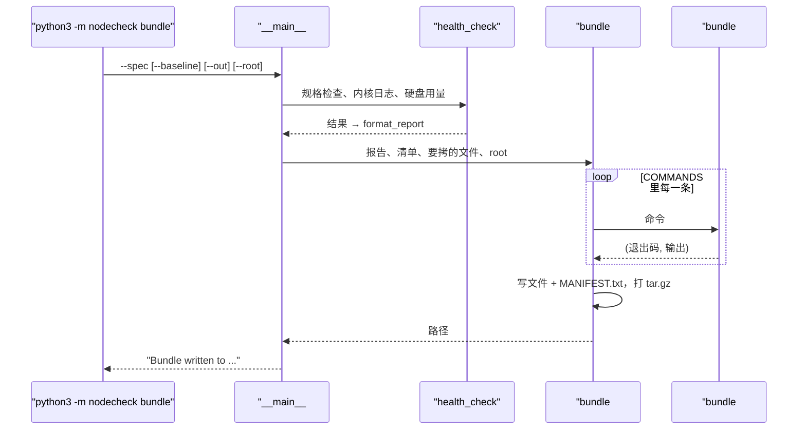

# 08 · 一条命令保住证据：日志打包

[English](08-log-bundle.md)

> 步骤类型：打包是**补缺的行为**（红 → 绿）；排查记录和 README 是**检查清单**。

## 1. 问题

工具现在能报 FAIL 了。接下来就是有人登上机器，敲十几条命令去找原因：慢、容易漏，还可能已经重启过，内核的环形缓冲区、网卡计数、tc 规则都被清掉了。证据应该**一次、每次都用同样的方法**收齐，放进一个文件，交给排查的人。

复现测试：`tests/test_bundle.py`（9 个用例）。命令由假的执行器回答，不用 VM；体检报告和硬件清单用 node-1 的 fixture（`--root`）。`make()` 还是空壳时，9 个全因断言失败而红（最早一版因为压缩包不存在报 `FileNotFoundError`；测试的辅助函数改成"没有包就当空包"，红的原因才是"内容不对"）。

node-1 上真跑，故意在 eth0 上留一条 netem 规则：

```
$ python3 -m nodecheck bundle --spec config/b2ats_v2.json --baseline baselines/node-1.json --out /tmp/nodecheck-node-1-drill.tar.gz
Bundle written to /tmp/nodecheck-node-1-drill.tar.gz
$ tar xzf nodecheck-node-1-drill.tar.gz -O nodecheck-node-1-drill/tc-qdisc.txt
qdisc noqueue 0: dev lo root refcnt 2
qdisc netem 800b: dev eth0 root refcnt 65 limit 10000 delay 2ms
```

## 2. 是什么

**收什么**（17 个文件加一份清单，放在一个文件夹里）

| 文件 | 回答什么 |
|---|---|
| `check.txt` | 体检结论，和 `check` 打印的一模一样 |
| `inventory.json` | 硬件是什么 |
| `journalctl-kernel.txt` | `journalctl -k -b`：这次开机内核说了什么 |
| `journalctl-err.txt` | `journalctl -p err -b`：这次开机所有程序报的错 |
| `df.txt`、`df-i.txt` | 有没有文件系统满了（空间或 inode） |
| `free.txt`、`lscpu.txt`、`uname.txt`、`uptime.txt`、`os-release` | 内存、CPU、内核、开机多久、什么系统 |
| `ip-link.txt`、`ip-addr.txt`、`ss.txt` | 网卡状态和收发 / 错误 / 丢包计数（`ip -s`）、地址、连接汇总 |
| **`tc-qdisc.txt`** | 网卡上有没有挂着限速或延迟规则 |
| `spec.json`、`baseline.json` | 结论是拿什么标准判的 |

**MANIFEST.txt**：每个文件一行，用 tab 分隔：文件名、退出码（没装的写 `not found`，卡住的写 `timeout`）、字节数、命令。node-1 上 17 条全是 0；`journalctl-err.txt` 只有 63 字节，就一行，是规格里已经忽略的那条 `/dev/sr0`。

**规矩**：只读、不要 root、**固定清单**：不按通配符去捡文件，密钥、`/etc/shadow` 不会混进来。某条命令失败不中断，它的输出和退出码照样留下，因为"收不到"本身也是线索。`bundle` 自己在包写成功时退出码是 0：它只收集，不判断。

| 代码 | 做什么 |
|---|---|
| `bundle.COMMANDS`、`bundle.FILES` | 固定清单：文件名 → 命令，文件名 → 路径 |
| `bundle#run` | 跑一条命令，stdout 和 stderr 合在一起；没装 → `(None, "")`，卡住 → `("timeout", "")` |
| `bundle#make` | 在一个和包同名的临时文件夹里写好每个文件和 `MANIFEST.txt`，再打成 tar.gz |
| `__main__#health_check` | 规格检查 + 内核日志 + 硬盘用量，`check` 和 `bundle` 共用 |
| `__main__#main`（`bundle`） | 生成报告和清单，起名 `nodecheck-<主机>-<UTC 时间>.tar.gz`，调用 `make` |

**排查记录**（`docs/incidents/2026-11-11-added-latency.md`）用 blameless postmortem（不追责的事后复盘）格式：摘要、影响、怎么发现、时间线、根因、怎么修、做得好和不好的、后续事项、教训。"不追责"是写清楚系统和流程允许了什么，而不是谁犯了错，这样大家才愿意早点报问题。

## 3. 代码路径



## 4. 为什么这样做

| 选择 | 为什么 | 替代方案和代价 |
|---|---|---|
| 🤖 固定清单 | 可预期、能审核、不会意外收进敏感信息 | 按 `/var/log/*` 捡：更全，但可能扫进密钥和超大文件 |
| 🤖 不要 root | 能跑体检的地方就能打包；`adm` 组就能读 `journalctl` | `sudo`：能拿 `dmesg` 和更多日志，但要权限，包传来传去风险更大 |
| 🤖 失败了继续收，记下来 | 有一部分证据比什么都没有强；缺了什么本身就是信息 | 遇错就停：少装一个工具就什么都没有 |
| 🤖 收 `tc qdisc show` | 忘拆的 tc 规则和真网络故障一模一样；演练里一直在加、拆 | 不收：排查的人得自己想到 |
| 🤖 报告和 `check` 用同一个函数生成 | 包里写的就是 `check` 说的 | 再写一遍：两个版本会慢慢不一样 |
| 🤖 包里一个文件夹，和包同名 | 解开很多个包不会混在一起 | 文件直接放顶层：乱 |
| 🤖 打包走红 → 绿，文档走检查清单 | 打包是能测的行为；文档靠人读来审 | 给文档写测试：价值小 |

**限制**：包里有主机名、私有 IP、MAC 地址和日志。团队内部没问题；**发给外部（比如厂商）之前要先看、该打码的打码**。

## 5. 八股在这里

**结论**：代码很简单；功夫在**收什么、什么时候收、什么不收**。

| 八股 | 代码在哪 | 这里的判断 |
|---|---|---|
| 📗 DE-L排查7 "系统很慢"怎么办 | 包里的内容 | 用证据缩小范围：CPU、内存、盘、网络、日志，加上 USE 方法。打包就是把"第一眼"存下来 |
| 📗 TS-JS32 为什么要留旧日志 | `journalctl -k -b` | 这次开机的日志会被 `dmesg` 的环形缓冲区覆盖，重装后就没了；动手之前先存 |
| 📗 TS-RS37 / TS-SS37 strace、跟踪系统调用 | 没用 | 用来查某一个进程，不是整台机器的快照。**什么时候用**：某个程序卡住或失败、又没有有用的日志 |
| ➕ sos report（sosreport） | `bundle` 的思路 | 企业版 Linux 上干这件事的标准工具；我们的是一个小的、固定清单的版本 |
| ➕ blameless postmortem | `docs/incidents/` | 写系统允许了什么，不写谁错了 |
| ➕ 忘拆的 tc 规则 | `tc-qdisc.txt` | 包里直接看到了留在 eth0 上的 netem |

场景锚点：
- "When a check fails, one command collects the report, the kernel and error logs, disk, memory, network and tc state into an archive, with a manifest of what was collected and what failed."
- "In a drill I left a netem rule on the NIC, and it showed up in the bundle straight away: exactly the kind of thing that wastes hours if you have to discover it by hand."

## 6. 面试追问链

1. **凌晨 3 点一台机器体检 FAIL，你先做什么？** 动手之前先保住证据：一条命令存下体检报告、日志和状态。
2. **收什么？** 这次开机的内核和错误日志、盘和 inode 用量、内存、CPU、网卡计数、地址、连接、tc 规则，加上当时用的规格和 baseline。
3. **不收什么？** 密钥、密码文件、清单外的一切；离开团队前要审一遍。
4. **工具没装怎么办？** 在清单里记下来，继续收。
5. **事后怎么写？** blameless postmortem：时间线、影响、根因、修复、后续事项、教训。

## 7. 英文说法

- "Before touching a broken node, I save the evidence with one command."
- "The bundle keeps going if a command fails, and the manifest says what's missing."
- "My write-ups are blameless: they describe what the system allowed, not who made the mistake."

## 8. 资料

- Google SRE 书第 15 章：Postmortem Culture（"Blameless postmortems are a tenet of SRE culture"） — https://sre.google/sre-book/postmortem-culture/
- sos（sos report）："a unified tool for collecting system logs and other debug information" — https://github.com/sosreport/sos
- journalctl(1)：`-k`、`-b`、`-p` — https://man7.org/linux/man-pages/man1/journalctl.1.html
- ip(8)：`-s` "Output more information" — https://man7.org/linux/man-pages/man8/ip.8.html
- ss(8)：`-s` "Print summary statistics" — https://man7.org/linux/man-pages/man8/ss.8.html

## 9. 自测题

<details>
<summary>1. 机器体检明明 FAIL，bundle 的退出码却是 0。是 bug 吗？</summary>

不是。`bundle` 只收集，包写成功就是 0。结论在包里的 `check.txt`。
</details>

<details>
<summary>2. 机器上没装某个工具，包里它那一项是什么？</summary>

一个空文件，清单里那一行写 `not found`、0 字节。其他照常收。
</details>

<details>
<summary>3. （真懂才答得出）为什么日志包里要收 `tc qdisc show`？为什么一定要在有人重启机器之前打包？</summary>

网卡上留着的 tc 规则（限速或加延迟）看起来和网络故障一模一样，而日志里没有任何地方提到它。而且 tc 规则、内核的环形缓冲区（`dmesg`）、网卡计数、连接状态，重启后都会丢失或清零；journal 只有存在磁盘上才留得下，还得用 `-b -1` 去上一次开机里找。所以要先存下来。
</details>

## 10. 预计回放时间

15 分钟。
